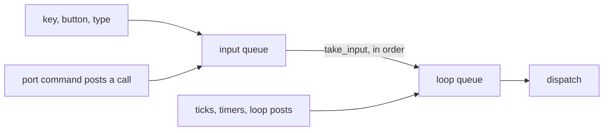
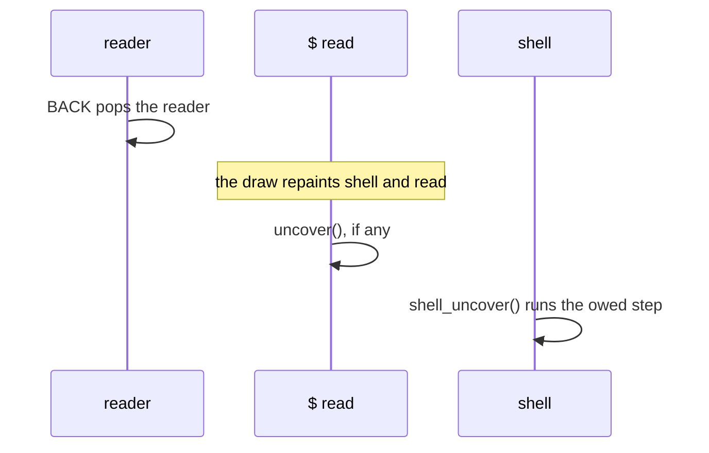
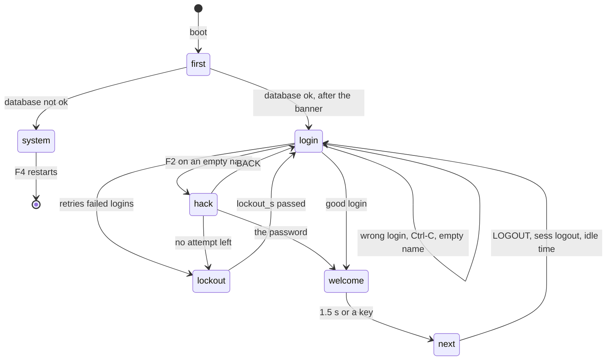
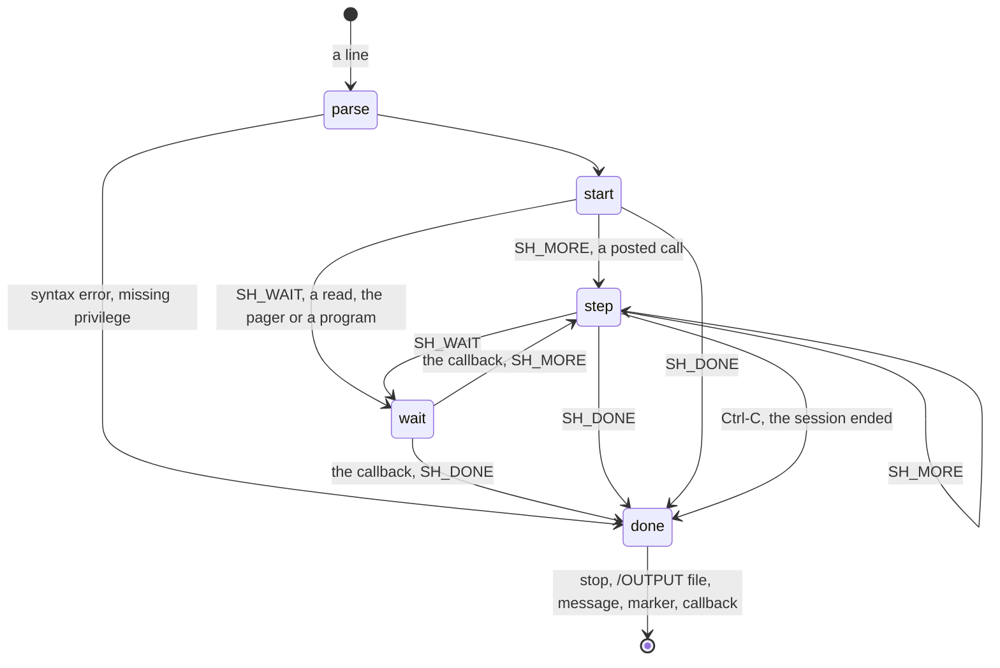
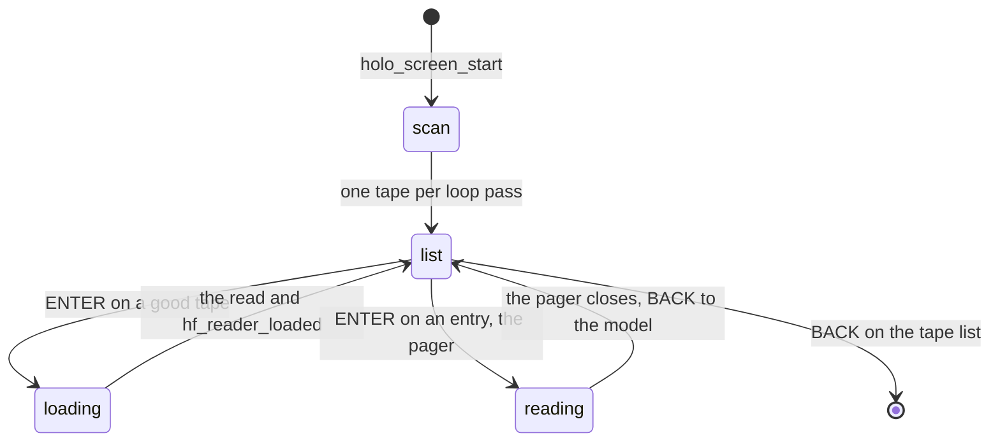
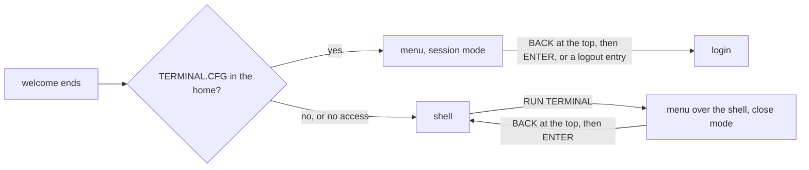
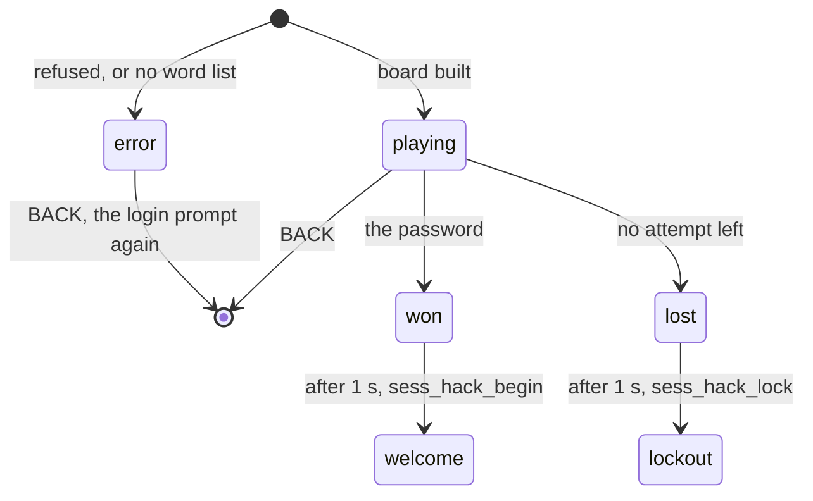

# UOS architecture

This describes the kernel base and the pure modules. Nothing is validated on real hardware.

## Layout

```
src/kernel/   entry, panic, event loop, timers, screens, settings, maintenance port, first screen,
              the shared privilege bits, the service table
src/dcl/ src/vfs/ src/session/ src/osk/ src/dev/ src/tui/ src/hack/ src/holo/
              the pure modules, one folder each
src/shell/    the command shell and its commands
card/         the default card: /UOS/UOS.CFG, SYSUAF.DAT, SYSUAF.DEF, DEVICES.CFG, HOME/, WORDS/, HOLO/, SYS/HELP/
tools/        card tools: mkuaf.py, mkwords.py, mkholo.py, and the holotape sources in holotapes/
tests/host/   host tests of the pure files, and host tools such as holocheck.c
tests/tools/  pytest tests of the card tools
tests/        QEMU target tests
```

## The pure split

A pure file has no hardware access, no kernel calls and no allocation. Its state lives in structs the caller owns. Every decision lives in pure code and has host tests. Hardware-side files are thin.

| Pure file | Role |
|---|---|
| `src/kernel/event.c` | The event queue, `uos_event.h` |
| `src/kernel/timerq.c` | Timers in ticks, `uos_timer.h` |
| `src/kernel/screen.c` | The screen stack, `uos_screen.h` |
| `src/kernel/settings.c` | The `UOS.CFG` reader, `uos_settings.h` |
| `src/kernel/buttons.c` | The six button pins and the `buttons` step's result, `uos_buttons.h` |
| `src/kernel/bootlines.c` | The first screen's text, `bootlines.h` |
| `src/kernel/maintreg.c` | The maintenance command table and its word splitting, `uos_maint.h` |
| `src/kernel/service.c` | The rules that run the service table, `uos_service.h` |
| `src/kernel/u64dec.c` | Decimal text of a 64-bit value with no division, `uos_u64.h` |

The hardware side is `main.c`, `loop.c`, `panic.c`, `maint.c`, `first.c`, `services.c` and `svc_uptime.c`. Their calls are in `uos.h`, `uos_maint.h` and `uos_service.h`.

The modules below are pure too. The image links them, but no kernel code calls them yet, so the linker drops them.

## Modules

Each module has a reference page in `docs/modules/`. The on-card formats are gathered in [FORMATS.md](FORMATS.md). The services of [Services](#services) use `dcl`, `vfs path`, `osk`, `dev`, `session`, `hack`, `holo` and the pager of `tui`. The shell uses `dcl` for every command line. The terminal menu uses `tui`, see [Terminal menu](#terminal-menu).

Every module that tests privileges uses the bits of `src/kernel/uos_privs.h`: `SYSTEM` bit 0, `OPER` bit 1, `SECURITY` bit 2, `READALL` bit 3. Each module keeps its own names, such as `DCL_PRIV_OPER` or `UAF_PRIV_OPER`, as aliases, and static asserts check them.

[dcl](modules/dcl.md): the command language in the style of DCL. It splits a line into a verb, qualifiers and parameters, looks names up by the abbreviation rule, checks the privileges each verb needs and formats the system messages. Pure files: `src/dcl/dcl.c`, `msg.c`, `tables.c`. Public header: `src/dcl/dcl.h`, prefix `dcl_`.

[vfs path](modules/vfs-path.md): file specifications such as `SD0:[HOME.ADMIN]A.TXT;1`. It turns them into FAT paths and back, expands logical names and wildcards, and decides file access. Pure file: `src/vfs/path.c`. Public header: `src/vfs/path.h`, prefix `vp_`.

[session](modules/session.md): users and login. It holds SHA-256, the `SYSUAF.DAT` user database with its iterated password hash, the login lockout and the login rules. Pure files: `src/session/sha256.c`, `uaf.c`, `lockout.c`, `login.c`. Public headers: `sha256.h`, `uaf.h`, `lockout.h`, `login.h`, prefixes `sha_`, `uaf_`, `lk_`, `lg_`. The session service's header is `sess.h`, see [Session](#session).

[osk](modules/osk.md): the on-screen keyboard for text entry with buttons only. It keeps the highlight and the layer and emits key events for the line editor. Pure file: `src/osk/osk.c`. Public header: `src/osk/osk.h`, prefix `osk_`.

[dev](modules/dev.md): device control. It parses `DEVICES.CFG`, keeps each device's state, turns commands into pin operations with their timing and formats status lines. Pure files: `src/dev/devcfg.c`, `devstate.c`. Public header: `src/dev/dev.h`, prefix `dv_`.

[tui](modules/tui.md): the menu-driven terminal screen and the pager. It parses `TERMINAL.CFG`, runs the menu model and lays out the screen. Pure files: `src/tui/tuicfg.c`, `tui.c`, `pager.c`. Public header: `src/tui/tui.h`, prefixes `tui_` and `pg_`. The screen's header is `tuiscr.h`, see [Terminal menu](#terminal-menu).

[hack](modules/hack.md): the password minigame. It parses the word lists, picks the candidates, builds the board and runs the game with its lockout timer. Pure files: `src/hack/hack.c`, and `hackui.c` for the screen's layout, keys and states, prefix `hg_`. Public header: `src/hack/hack.h`, prefix `hk_`. The screen's header is `hackscr.h`, see [Password game](#password-game).

[holo](modules/holo.md): data holotapes. It validates a tape in memory, gives its title and entries, and runs the reader model. Pure files: `src/holo/holofmt.c`, `holoread.c`, and `holoscan.c` for the screen's scan and load results, prefix `hs_`. Public header: `src/holo/holofmt.h`, prefix `hf_`. The screen's header is `holoscr.h`, see [Holotape reader](#holotape-reader).

## Boot order

Each step prints one marker, `@RC stage=uos ev=<name> ...`, in this order:

| Marker | Step |
|---|---|
| `boot` | The PL011 at 115200. `version`, `entry_mode`. |
| `handoff` | The trust rule of RobCo-Core's `BOOT_PROTOCOL.md`: `trusted`, `prev` stage, `flags`. A cold boot copies the firmware blob. The exception hook goes to the panic path. |
| `maint` | The mini UART for the maintenance port: `mini` is its init result |
| `board` | MIDR, SoC, peripheral base, board revision |
| `mbox` | The ARM memory from the mailbox |
| `mmu` | `mmu_init()` and `mmu_enable()`: the MMU, the caches and branch prediction. `result=on`, `off` or `err`, with `rc`. See [Memory](#memory). |
| `screen` | `fb_init()` at 640x480x32 and `console_init()` on a cleared screen. The scheme comes from a trusted boot info, else green: `source=bootinfo` or `default`. |
| `tick` | IRQs and the tick at 100 Hz. A failure panics. |
| `heap` | The heap from `robco_heap_high()`, from `0x01000000` to the top of ARM memory |
| `input` | The console backend and the maintenance port commands. `gpio=later`: the `buttons` step starts the GPIO backend. |
| `selfcheck` | `rimg_self_check()`, run first at entry and reported here. Information only. |
| `mount` | The card by `fs_mount_boot()` with markers `/UOS/UOS.CFG` and `/ROBCO/UOS.SYS`, then the `/UOS` folder: `result=ok`, `none` or `notree` |
| `config` | `UOS.CFG`: `result=ok`, `syntax`, `missing`, `skipped` or `bad`, with every setting and the counts. It has no `mode=` field: UOS reads no `mode` key. Every `config` marker ends with `buttons=<0\|1>`, the `[input] buttons` setting that applies, the default `1` when the file is missing or cannot be read. |
| `buttons` | The six panel buttons of `src/kernel/buttons.c`: UP 5, DOWN 6, LEFT 17, RIGHT 22, SELECT 26, BACK 27, active low with pull-ups and a 20 ms debounce. It calls `input_gpio_start()`, then sleeps in `wfi` until the library's 10-tick stuck-line guard ends, 30 ticks at most. `result=active`, `disabled_stuck`, `off`, `error` or `checking`, with `rc`, `setting`, `repeat` and `ticks`, the wait. Repeat, 500 ms then every 150 ms, is set before the guard, so a button held through it repeats. The step turns it off again unless the result is `active`. `repeat` holds the code of the call that set it when `active`, else `none`. `off` touches no pin. `error` sets `error=buttons`. A plain QEMU boot drives no line, so it reads `disabled_stuck`. |
| `rtc` | I2C and a DS1307 or DS3231 clock, if one answers |
| `service` | One line per service, in table order: `name`, `rc`. See [Services](#services). |
| `ready` | The first screen is drawn, or the login replaced it: `screen=first` or `screen=login` |

When there is no card or no `/UOS` folder, UOS still reaches the first screen. The screen says what is missing, `state` reports it and the maintenance port works.

A service whose init fails does not stop the boot. It sets `error=service`.

A `UOS.CFG` scheme applies only when the boot info gave none. Bad values are skipped, out-of-range numbers are clamped to the range, and both set `error=config`.

## The event loop

One thread of control. `uos_loop_run()` repeats:

1. Posts one `TICK` event for the ticks since the last one, and one `TIMER` event per timer expiry due.
2. Takes input events while the queue has room, in the order the input layer received them, port calls included. Key releases and dial turns are dropped. The rest waits in the input layer.
3. Delivers the events queued before this step, drawing the top screen after each one when it is dirty. An event posted meanwhile waits for the next pass, so a call that posts itself again, such as a copy step, runs once per pass and time and input get their turn between two steps.
4. Sleeps in `wfi`, through `input_wait()`, until input or the next tick. A pass that left events queued skips the sleep.

Each `TICK` event first calls the `tick` function of every started service, then goes to the screens.

Event types, `uos_event.h`: `KEY`, `CHAR`, `TICK`, `TIMER` and `CALL`. `uos_post(fn, arg)` queues a call from main context. The queue holds 32 events. A full queue refuses an event and counts it in `uos_events_dropped()`: `uos_post()` then returns `UOS_EVQ_ERR_FULL`, and the call never runs unless the caller posts it again. A key that finds the queue full is dropped and counted. Under a flood the loop takes input only while there is room, so drops are rare; the PL011 console then stalls instead of dropping.

Maintenance commands run inside `input_poll()`, while the loop may hold keys it took and has not dispatched. `uos_input_pending()`, loop only, counts both those keys and the events still in the input layer, port calls included. Every `pending=` field of a state reply uses it.

### Arrival order

What the system received first is handled first, whatever path it came in on. Keys go into the input layer's queue. A call that a maintenance command posts with `uos_post()` goes into the same queue, behind the keys received before the command. The input event has the UOS type `UOS_INPUT_EV_CALL`, and its code names a slot of the port call table, `uos_portcall.h`. The loop turns input events into kernel events in queue order, so the call runs after every earlier key and before every later one.

The rule holds by construction. `maint.c` marks the time a command runs with `uos_port_command()`, and `uos_post()` routes the call by that mark. A new command cannot post around the queue. A call posted from the loop, such as a stepped copy, still goes straight into the loop's queue.



What stays the same:

- The loop still runs only the events queued before each pass.
- Ticks and timers still enter the loop's queue before the input of the same pass. Their order relative to input is unchanged.
- The input queue keeps its `INPUT_DROP_NEWEST` policy. A full queue refuses the call, and the command answers `err full`. UOS never sets `INPUT_DROP_OLDEST`: under it a dropped call would keep its slot.
- A key goes to the screen on top when the loop dispatches it. A call posted after a key that changes screens runs on the new screen, as a key sent at that point would.

A port call counts in `pending=` until it has run. The holotape reader and the password game add their own count of posted calls, so their count can be higher than the work left. Zero still means everything sent before the query has been handled.

### Timers

`uos_timer_start(delay, period, fn, arg, &id)` starts a timer in ticks: once when `period` is 0, else every `period` ticks. At expiry the loop runs `fn(arg)`, or, when `fn` is NULL, gives the screens a `TIMER` event. `uos_timer_cancel(id)` ends it. A timer never fires after its cancel returns, even when its expiry is already queued: the loop checks the id first. Deadlines compare by signed difference, so the tick counter may wrap. Delays and periods go up to `0x7fffffff` ticks. At most 16 timers live at once.

Time goes into the queue before input. After a pass the queue holds at most one event, so the `TICK` and all 16 expiries fit. A timer fires on the first loop pass at or after its deadline, however much input waits.

An expiry is never lost. `uos_tq_deliver()` in `timerq.c` queues one `TIMER` event per due expiry, most overdue first. It marks an expiry delivered only once its event is queued. An expiry that finds the queue full stays due and goes out on a later pass:

- A one-shot timer fires once, as soon as there is room.
- A periodic timer fires once per period, missed periods included. It does not coalesce: the count stays exact, and a callback that counts periods stays right.
- A cancel ends the timer, pending expiry included. It never fires after the cancel returns.
- A `TICK` that finds the queue full is retried with the ticks added up.

### Screens

A screen is a struct of `enter`, `leave`, `event`, `draw` and `uncover` callbacks and a `ctx` pointer. The kernel keeps a stack of up to 8:

- `uos_screen_push()` puts a screen on top, such as the holotape reader. The screen below gets no `leave`.
- `uos_screen_push_child(s, owner)` puts a child on top, such as a read line or a pager a screen opens for itself. See [Owners and children](#owners-and-children).
- `uos_screen_pop(s)` removes `s` when it is the top. The last screen cannot be popped.
- `uos_screen_unwind()` pops every screen above the bottom one. Only a reset of the whole stack uses it, such as a logout or a lockout.
- `uos_screen_on_top(s)` tells whether `s` is the top. `uos_screen_unit_on_top(s)` tells whether `s` or a child it owns is the top.
- `uos_screen_replace()` swaps the top.
- Events go to the top first. When its `event()` returns 0, the next screen down gets the event.
- `uos_screen_invalidate()` asks for a redraw of the top screen.
- `uos_screen_dirty(s)` says that `s` changed. On top, the stack redraws it. Covered by partial screens only, the stack redraws from the highest full screen up, so `s` and the screens over it repaint in order. Under a full screen, nothing draws until a pop shows `s` again.

A screen is full or partial. A full screen sets `.full = 1`: its `draw()` clears the console, paints every row and calls `con_status_redraw()` last. A partial screen paints only its own rows: the read line, the on-screen keyboard and the pause line are partial.

The redraw rule: no screen draws what is under it. The stack does it.

- After a push or an invalidate, the next draw runs the top's `draw()` only. A read line or a keystroke stays cheap.
- A pop or a replace marks the stack exposed. The next draw then runs the `draw()` of every visible screen, bottom-up: from the highest full screen, or from the bottom when none is full, to the top.
- `uos_screen_expose()` asks for the same full redraw. The read screen calls it when the on-screen keyboard closes, so the rows under the keyboard come back.

So BACK from the holotape reader over the login's user name prompt draws the login screen, then the read line. The table in [TESTING.md](TESTING.md#screen-redraws) lists every pair of screens checked.

A held key sends one press, then repeats. Movement and typed characters may repeat. An action that confirms, cancels, changes screen, starts a load or leaves takes only the press: test it with `uos_ev_fresh_key()` from `uos_event.h`, and consume the repeats. The stack adds one rule of its own: a key press that pushes, pops or replaces a screen spends that key, and `uos_ss_event()` drops its repeats until the next press. So a held BACK that closes a screen never reaches the screen below.

#### Covered screens

A screen that is not the top is covered. A covered screen takes no posted action: only the top acts. The rule covers every road that reaches a screen without a key, such as a maintenance command, a posted call, a timer or a `done` callback. Each on-top check is one of two kinds.

- A port command with a reply. Refusing is right: the caller sees `covered`. `hack move`, `hack select`, `hack back`, `holo pick`, `osk open`, `osk close` and `sh run` do nothing under another screen and mark `result=covered`, or `why=covered` for `sh run`.
- An internal continuation: a posted call, a timer, a `done` callback or a step of a state machine. Returning in silence would lose work the screen needs. So the screen records what it owes and does it in its `uncover()` callback.

The stack calls `uncover()` once each time a pop or an unwind leaves the screen on top, after the next draw. A push or a replace before that draw cancels the call: the screen is covered again or gone. The stack clears its mark before the call, so `uncover()` may push or pop. Each continuation and its `uncover()` share one guard, such as "no read runs", so the work runs once whichever comes first.

| Screen | Continuation | Owed while covered |
|---|---|---|
| `login` | `start_user`, posted after an empty name, a cancel or a wrong password | The user name read |
| `shell` | `shell_idle`, posted after each line or command | The `$` read |
| `hack` | `pause_end`, the 1 s result pause | The game's end. It marks `ev=hack op=wait why=covered` once |
| `first` | `show`, the end of the banner | The handover to the login |
| `shell` | `drive`, a command's posted step | The step. It marks `ev=sh op=wait why=covered owe=step` once |
| `shell` | `sh_resume(SH_DONE)`, a command's end, such as a program's `done()` | The end and its result line. It marks `owe=end` |
| `menu` | A command entry's step or end, the job of `sh_run_line_on()` | The same debt, paid by `menu_uncover()` through `sh_host_uncover()` |

A running command waits whole while another screen covers the shell. Any step may ask a `/CONFIRM` question, read a `CREATE` line or a password, open the `TYPE /PAGE` pager or print. `con_print()` writes to the console cells at once, so a step's output would paint over the covering screen. So no step runs, quiet or not. The shell records the step or the end it owes, and `shell_uncover()` runs it with `ev=sh op=resume owe=`. `sh_owe_take()` clears the debt before the work, and `sh_resume()` posts at most one step, so the work runs once. An end outranks a step.

Nothing starts on a covered shell, nor before the shell's screen is on the stack: `sh_run_line()` returns `SH_ERR_COVERED`, so no command, question or program starts. `sh run` already replies `covered`. The shell's own `$` read is its child, so it does not cover the shell. A command the API starts while that read waits runs under it. When the reader covers that read and closes, the step the command owes runs at once, with no key.

Ctrl-C while a command waits under the reader goes to the reader, the top screen. The command neither ends nor asks. Once the reader closes, the question opens and Ctrl-C there cancels the command.

The shell's pushes and their rule:

| Push from the shell's side | Covered shell, before | Now |
|---|---|---|
| `sh_ask()`: `/CONFIRM`, `CREATE` line, password | The read line opened over the covering screen | The step waits. A start through `sh_run_line()` is refused |
| `con_page_text()` in `TYPE /PAGE` | The pager opened over the covering screen | The step waits |
| A program's `start()` through `RUN` | Could start through `sh_run_line()` | Refused with `SH_ERR_COVERED` |
| Any job during the welcome, before the shell's screen exists | Ran and printed over the welcome | Refused with `SH_ERR_COVERED`; `sh run` marks `why=covered` |
| `con_print()` through `sh_out()` and the end message | Painted over the covering screen | The step or the end waits |
| `prompt_start()`, the `$` read | Already waited in `shell_idle()` | Unchanged |

The invariant: a screen that is on top while no command runs has an active read or takes keys itself. The login, the shell, the game, the pager, the lockout, the welcome and the first screen take keys themselves; the login and the shell also own a read in their prompt states. Tests in `tests/test_screens.py` cover each prompt state with the reader at the moment its next step is due, close the reader and type on.

Other rules:

- A pop names its own screen. `uos_screen_pop(s)` refuses when `s` is not the top: it returns `UOS_SCREEN_ERR_TOP` and marks `ev=screen pop=refused want= top=`. A test build panics there, so a wrong pop fails loudly.
- A session reset ends every screen at once with `uos_screen_unwind()`: a logout, a lockout, the welcome's end and a won game's session. It pops from the top down, so no screen pops another.
- Background work on a covered screen, such as the holotape scan and load steps, may change that screen's own state. It never pushes or pops.
- Only the draw pass paints. A timer, a tick or a posted call changes its screen's state and calls `uos_screen_dirty()` with that screen. It never calls `draw()` or writes cells itself. So the state moves on while the screen is covered, and the stack shows the real state once the screen shows again.
- A session reset ends a covered screen too. A lockout's start or end, the welcome's end, an idle logout and `sess logout` unwind the whole stack, the reader included, and show the next screen with its read.
- A job whose shell a reset took away is an orphan. It takes no step and prints nothing, and the shell's next tick ends it with `CANCEL`.

Each site that changes a screen from outside a key to that screen:

| Site | Screen | How it paints | Covered |
|---|---|---|---|
| `on_clock`, the 1 s clock | `first` | `uos_screen_dirty()` | The clock reads the time; the stack shows it once uncovered |
| `show`, the banner's end with no database | `first` | `uos_screen_dirty()` | Nothing paints; the screen shows when the cover pops |
| `lock_second`, the countdown | `lockout` | `uos_screen_dirty()` | The draw computes the time left from the clock, so it is right once uncovered. The end resets the stack |
| `welcome_done`, 1.5 s | `welcome` | A reset | The reset ends the cover |
| `pause_end`, the result pause | `hack` | Owed to `uncover()` | Waits, marks `hack op=wait` |
| `scan_step`, `load_step` | `holo` | `uos_screen_dirty()` | The scan and the load go on; the list shows once uncovered |
| `drive`, a job's step | `shell` | `con_print()` | Owed to `uncover()`; an orphan takes no step |
| `drive`, a menu command's step | `menu` | Nothing: the output is kept for the callback | Owed to the menu's `uncover()` |
| `holo_done`, `pager_done`, `cmd_done` | `menu` | `uos_screen_dirty()` | They run when the menu is the top again: the screen over it has just closed, or the job's end waited for it |
| The read line and the keyboard | `readline` | Their `event()` | Keys reach them only on top. There is no blinking cursor |

#### Owners and children

A screen often opens a child screen for itself: a read line, a pager or a pause. The owner and its children form one unit. `uos_screen_push_child(s, owner)` pushes the child with its owner, and `con_read_line()`, `con_page_text()` and `con_pause()` take the owner as their first argument. A maintenance command that opens a read or a pager passes `NULL`: its screen belongs to nobody.

| Owner | Child | What the owner owes while its unit is covered |
|---|---|---|
| `shell` | the `$`, `_$` and parameter reads | A command's step or end, started through the API under the read |
| `shell` | a command's `/CONFIRM`, `CREATE` line or password read | Nothing: the command waits for the answer |
| `shell` | the `TYPE /PAGE` pager | Nothing: the command waits for the pager |
| `login` | the `USERNAME:` and `PASSWORD:` reads | Nothing: the next read starts after this one ends |
| `holo` | the entry pager | Nothing: the scan never pushes or pops |
| `menu` | the pager of a text entry or of a command's output | Nothing: the menu waits for the pager |
| `menu` | a command entry's `/CONFIRM`, `CREATE` line or password read | Nothing: the command waits for the answer |

The on-screen keyboard is part of the read line, not a screen.

Two checks answer two questions.

- `uos_screen_unit_on_top(s)`: is `s` or a child it owns the top? This says whether the unit is covered. The shell's `covered()`, `sh run`, `sess_prompt_on_top()` and `con_line_on_top()` use it.
- `uos_screen_on_top(s)`: is `s` itself the top? A command that stands in for a key uses it, such as `holo pick` or `osk open`, since the child takes the keys.

When a pop leaves a child on top, the next draw calls `uncover()` for the child, then for each owner down the chain, top first. Each runs at most once. The chain stops at a screen whose unit is no longer on top, such as after an `uncover()` that pushed another screen. When an `uncover()` pops its own screen, the new top is marked again, and the next draw calls it and its owners. So no screen runs its `uncover()` twice for one uncovering.



An owner's `uncover()` must expect its child on top. Each one has a guard: `shell_idle()` does nothing while `shp.reading` or a job runs, `sh_owe_take()` clears a debt once, and `start_user()` does nothing while `reading_user` is set or a read runs.

The invariant: when the covering screen leaves, every screen of the unit that owes work runs it exactly once, in stack order from the top down. No step of a job is lost or runs twice.

#### How to add a screen

1. Fill a `uos_screen_t` with a short `name`, the callbacks you need and `ctx`.
2. When `draw()` clears the console and paints everything, set `.full = 1` and call `con_status_redraw()` last. Otherwise leave `full` at 0 and paint only your rows.
3. Never call another screen's `draw()`. When a partial screen shrinks, call `uos_screen_expose()`.
4. Close with `uos_screen_pop(&your_screen)`. The screens below come back on their own.
5. A maintenance command that acts on your screen checks `uos_screen_on_top()` first and replies `covered`. A posted call or a timer that finds your screen covered records the work and does it in `uncover()`, as in [Covered screens](#covered-screens). When your screen opens a read, a pager or a pause for itself, pass your screen as the owner and test "covered" with `uos_screen_unit_on_top()`, as in [Owners and children](#owners-and-children).
6. Apply the held-key rule above to each action.
7. Add a `@RC` marker and a maintenance command, and a test in `tests/test_screens.py` that compares the grid before the screen opens and after it closes.

## The first screen

`first.c` shows the banner from `bootlines.c` for half a second. Then one of two things happens:

- When the session service loaded the user database, it called `uos_first_set_next()` at its init. The login screen replaces the first screen and `ready` says `screen=login`.
- Otherwise the first screen stays as the system screen: the system name, two notice rows the session service set with `uos_first_set_notice()`, the card state, the settings state, the clock if a clock chip answered, and the last key. The notice says what is missing and what to do. F4 then restarts the terminal through `uos_reboot("user")`. A periodic one-second timer refreshes the clock.

Two keys test the timers. F1 starts a periodic timer of 10 ticks that fires 10 times, with an `ev=timer name=probe` marker each time. F2 starts a one-shot timer that a second timer cancels before it is due, and a third timer reports whether it fired. While a probe runs, its key is ignored, repeats included.

The banner lines are lore: in-world text, original to UOS.

## The panic path

`uos_panic(fmt, ...)` and the exception hook for undefined instructions and aborts share one path. It masks IRQs, prints `ev=panic kind=<call|undef|pabt|dabt> reason=<words_joined_by_underscores>`, with the registers after an exception, and shuts the services down with `why=panic`. It clears the screen and shows the reason and the registers. Then it prints `ev=idle` and polls the maintenance port for good.

The rule: from the moment a panic is possible, the maintenance port answers. The first way into the panic path is the exception hook, set at the `handoff` step. That comes before the mini UART and before `uos_maint_start()`. A failed tick also panics before `uos_maint_start()`. So when the port is not up yet, the panic path starts it itself, polled: the registry's base commands, `input_init()`, the command handler, `uart_mini_init()` if needed and `input_script_start()`. The script channel needs no tick and no IRQs. It prints `ev=port late=1 mini=<rc> script=<rc>` before `ev=idle`. `help`, `state`, `timers` and `reboot` then answer. `dump` answers once the screen is up, else `err no screen`. No `uos_panic()` call comes before the tick step.

A panic before the `service` markers has no service to shut down, so it prints no `ev=shutdown` marker.

When `UOS.CFG` turns the hardware watchdog on, the panic leaves it running with no kicks, so the board resets once its timeout ends, after the outputs went safe. See [The watchdogs](#the-watchdogs).

When the MMU is on, it stays on in the panic path. The vectors, the stacks and the framebuffer stay mapped, so the screen and the port keep working.

## Reboot and halt

`uos_reboot(source)` shuts the services down with `why=reboot`, prints `ev=reboot source=<source>`, turns the MMU and the data cache off with `mmu_disable()`, which cleans every dirty line to memory, and resets the board through the watchdog.

`uos_halt()` masks IRQs, shuts the services down with `why=halt`, sets the phase to `halt`, prints `ev=halt`, then `ev=idle`, and polls the maintenance port for good, as the panic path does. The device service's shutdown stops a running hardware watchdog on halt, so the terminal stays halted.

## The maintenance port

The mini UART script channel. In QEMU it is the second serial port. On a Pi the mini UART reaches no pin. Each answer is complete lines that start with `| `, then `ok` or `err <reason>`.

The library answers its built-in commands: `key`, `char`, `text`, `dial`, `wait` and `stats`. Every other line goes to the registry of `uos_maint.h`. It looks the first word up, splits the rest into words again and calls the command function. A word in double quotes keeps its spaces, and `""` inside quotes is one quote. A line holds at most 127 characters and 8 blank-separated words in all, quotes or not: the library refuses longer lines. An unknown first word gets `err unknown command`, an unclosed quote `err bad quotes`.

The base commands enter the table on the first use of the registry: `uos_maint_start()`, a `uos_maint_register()` call or the panic path, whichever comes first. So the base commands answer after any panic. A service's commands exist once its init has run.

| Command | Answer |
|---|---|
| `help` | One line per registered command, sorted by name: the name, then its help text |
| `state` | `phase=... screen=... user=... card=... trusted=... error=...`: the phase `init`, `ready` or `panic`; the top screen's name; the user; the card `ok`, `none` or `notree`; the trust result; the last error. `none` stands for nothing. |
| `screens` | `screens depth=<n> stack=<names>`: the screen stack, bottom to top, names joined with commas |
| `dump` | The console cells, from `console_dump()` |
| `key <name>` | Built in: presses and releases a key |
| `char <c>`, `text <s>` | Built in: characters |
| `type <words>` | The words as characters with single spaces, then SELECT. At most 30 characters, spaces included: the input queue holds 32 events, and SELECT takes a press and a release. A longer line answers `err full` and types nothing. For longer text a test sends several `type` or `text` commands. |
| `timers` | `timers count=<n> expired=<n>`, then `timer id=<id> due=<ticks> period=<ticks>` per live timer |
| `reboot` | Shuts the services down, `ev=reboot source=maint`, then a watchdog reset |
| `services` | `service name=<n> rc=<rc>` per service, in table order |
| `uptime` | `uptime s=<seconds> ticks=<ticks> start=<tick> last=<tick>`: the time since the tick started, the tick at which the uptime service started, and the tick of its last `tick` call |
| `fault undef`, `fault pabt`, `panic`, `halt` | Test builds only. They post the fault, `uos_panic()` or `uos_halt()` to the loop. |
| `bench uaf <n>` | Test builds only. Posts `uaf_hash()` over `n` iterations, 1 to 100000, on a fixed salt and password to the loop, which prints `ev=bench name=uaf iterations=<n> rc=<rc> ticks=<ticks> us=<us>` |

The test commands are not registered in the shipped image, and they answer `err unknown command` once the loop has stopped.

A command that acts posts its work, so it runs in arrival order with the keys, see [arrival order](#arrival-order). A query answers at once. A few commands act at once on purpose:

| Command | Kind | Why |
|---|---|---|
| `key`, `char`, `text`, `dial`, `type`, `button` | Input | They push input events into the input queue, in order by nature |
| `holo open`, `holo pick`, `hack start`, `hack move`, `hack select`, `hack back`, `hack seed`, `sess logout`, `sess login`, `fs` requests, `readline`, `page`, `osk open`, `osk close`, `dev stall`, `fault`, `panic`, `halt`, `bench` | Posts | Run in arrival order |
| `state`, `dump`, `timers`, `help`, `services`, `uptime`, `holo state`, `holo list`, `hack state`, `sess state`, `osk state`, `dev list`, `dev rec`, `stats` | Query | Answer at once. `pending=` tells a test that earlier input is not handled yet. |
| `reboot` | At once | A reset must work even when the loop is stuck or the queue is full |
| `wait` | At once | Built in: it holds the port, not the loop |
| `dev set` | At once | Its reply carries the new device state. A test that also types device commands waits for `pending=0` first. |
| `dev sense`, `dev fail`, `dev hang`, `holo hog`, `fs fakedev` | At once | Test builds only. They change the outside world: a sensor level, a pin fault, the watchdog feed, free memory, a fake device. Real hardware changes the same way, with no queue. |
| `fs default`, `fs who` | At once | They set the port's own path context. No screen reads it, and each `fs` request copies it when posted. |

## Services

A service starts once at boot and stops before a reboot, a halt or after a panic. `src/kernel/uos_service.h` defines it:

```c
typedef struct uos_service {
    const char *name;
    int  (*init)(void);
    void (*tick)(uint32_t now);
    void (*shutdown)(int why);
} uos_service_t;
```

- `init` runs once, in table order, after the card, the settings and the clock are read, before the loop runs. It returns 0 or a negative code. A failure does not stop the boot: the next service still starts, `state` shows `error=service`, and the failed service never gets `tick` or `shutdown`.
- `tick`, optional, runs from the loop on every `TICK` event, with the tick count.
- `shutdown`, optional, runs in reverse table order before a reboot, a halt and from the panic path. `why` is `UOS_SHUTDOWN_REBOOT`, `UOS_SHUTDOWN_HALT` or `UOS_SHUTDOWN_PANIC`. It runs at most once per boot and must be safe with interrupts off.

Markers: `ev=service name=<n> rc=<rc>` after each init, `ev=shutdown name=<n> why=<reboot|halt|panic>` before each shutdown.

Test builds put a service named `testfail` first, whose init returns -5, so the tests see the failure policy.

### Start and stop order

| Start | Service | Header | Uses |
|---|---|---|---|
| 1 | `uptime` | none | nothing |
| 2 | `vfs` | `src/vfs/vfs.h` | the card the kernel mounted |
| 3 | `console` | `src/console/con.h` | the screen stack |
| 4 | `session` | `src/session/sess.h` | `vfs` for `SYSUAF.DAT`, `console` for the prompts, the first screen |
| 5 | `shell` | `src/shell/sh.h` | `session` for the user and the next screen, `vfs`, `console`, `DEV:` |
| 6 | `devices` | `src/dev/devs.h` | `vfs` for `DEVICES.CFG` and `DEV:` |
| 7 | `holo` | `src/holo/holoscr.h` | `vfs` for the tapes, `console` for the pager, `session` for the user's rights |
| 8 | `hack` | `src/hack/hackscr.h` | `vfs` for the word lists, `session` for its rules, the lock and the session |
| 9 | `menu` | `src/tui/tuiscr.h` | `shell` for its programs, the session's screen and the command entries, `vfs`, `devices`, `holo`, `console` for the pager |

The session comes after the file system and the console, which it uses. The shell comes after the session, whose `sess_set_next()` it calls at init. Both come before the devices so that the devices stay last: they stop first. Nothing in the device service uses the session; a device command gets its caller's privileges as an argument.

The menu comes after the shell, whose `sh_program_register()` and `sh_session_screen_register()` it calls at init. Its place after `devices` does not break the stop rule above: it has no shutdown work.

Shutdown runs in reverse: `menu`, `hack`, `holo`, `devices`, `shell`, `session`, `console`, `vfs`, `uptime`. The two screen services have no shutdown work: they hold memory only. The shell has no `shutdown`. The menu has none either. So on a reboot, a halt and a panic the device service is the first service with work, and it drives every output safe before anything else stops. Its `devsafe` lines and `devdown` come right after `ev=shutdown name=devices` and before `ev=shutdown name=console`. `test_link.py` checks this order for all three causes.

A file write cannot be cut by a reboot. `vfs_write_all()` runs in one loop pass, and the `reboot` command waits for the next one. A stepped copy can be cut between two steps. Its new content sits in a work file, and the target keeps its whole old content. The next call that looks at the target removes the work file. `test_link.py` reboots during a 1 MiB copy over a file and checks both. A power cut during a write is not tested: the library's atomic write states that guarantee.

### Interfaces between services

- `DEV:` names. The device service's init calls `vfs_dev_register()` with its `read`, `write` and `list` hooks. The prototypes of `devs_hooks_t` and `vfs_dev_hooks_t` match field by field, but the codes do not: `DV_ERR_NOPRIV` is -15, and -15 is `VFS_E_NOMEM`. So `devglue.c` registers three small wrappers that pass each code through `devs_vfs_code()`, a pure function with host tests. An unknown device or an empty device table is `VFS_E_NODEV`, a missing privilege `VFS_E_NOPRIV`, a command to a sensor `VFS_E_READONLY`, a bad action word `VFS_E_ARG`. `fs cat DEV:DOOR1` shows a device's status line, `fs write DEV:DOOR1 OPEN` runs a command with the caller's privilege bits against the device's own mask, and `fs ls DEV:` lists the devices.
- `DEVICES.CFG`. The device service reads it with `vfs_sys_read_all()`. A missing file and a card with no `/UOS` folder are `missing`; a folder, a file over 8 KiB and a read error are `bad` with `why=` the `vfs_strerror()` word.
- Screens. The read screen and the pager are screens on the kernel's stack. A read may start while the pager is shown, and the pager while a line is read. The newer screen takes the keys until it pops. A device change does not touch the screens: a pulse end or a sensor change during a read leaves the line as typed. A panic while the on-screen keyboard is open replaces every row with the panic screen, and the read never calls back.
- Serial lines. The read screen echoes the line on the PL011 without a line end. `uos_serial_break()` ends that partial line before any marker, `uos_say()` line or `con_print()` line, so each starts on a line of its own.

### Maintenance commands

Every command each service registers. The `fs`, `readline`, `page` and `osk` commands post their work to the loop and report it with markers.

| Command | Service | Does |
|---|---|---|
| `uptime` | `uptime` | Seconds and ticks since start, the start tick and the last tick |
| `fs who\|default\|ls\|cat\|crc\|write\|new\|del\|ren\|copy\|mkdir\|stat\|free` | `vfs` | File calls as a test user, see [vfs](#vfs) |
| `fs pattern`, `fs fakedev` | `vfs` | Test builds only |
| `readline <flags> <max> [prompt]` | `console` | Reads a line, see [console](#console) |
| `page <short\|long\|empty\|big>` | `console` | Pages a built-in test text |
| `osk <open\|close\|state>` | `console` | The on-screen keyboard of the active read |
| `dev list\|set\|rec` | `devices` | Devices, commands, the pin record, see [Devices](#devices) |
| `dev sense`, `dev hang`, `dev stall` | `devices` | Test builds only |
| `sess state\|logout` | `session` | The login state and the session, see [Session](#session) |
| `sh state\|run` | `shell` | The prompt state; a command line run as the session, see [The shell](#the-shell) |
| `sh hold`, `sh park`, `sh prog` | `shell` | Test builds only: hold a command between two steps; hold a program's posted call; register and end a test program for `RUN` |
| `sess login <user>` | `session` | Test builds only: a session with no password |
| `button <key>` | `console` | Test builds only: a key from the GPIO source, which opens the on-screen keyboard during a read |
| `holo open\|list\|pick <n>\|state` | `holo` | The holotape reader, see [Holotape reader](#holotape-reader) |
| `holo hog` | `holo` | Test builds only: holds the heap until no tape fits, or gives it back |
| `hack start\|move <dir> [n]\|select\|back\|state` | `hack` | The password game, see [Password game](#password-game) |
| `hack seed <n>` | `hack` | Test builds only: the next games use a fixed seed |
| `menu state\|msg\|show\|list\|pick <n>\|back` | `menu` | The terminal menu, see [Terminal menu](#terminal-menu) |

### How to add a service

1. Write the service in its own file, for example `src/mail/svc.c`, ending with `const uos_service_t uos_svc_mail = { "mail", mail_init, NULL, mail_shutdown };`.
2. In `src/kernel/services.c`, add one line `extern const uos_service_t uos_svc_mail;` under the comment "One extern per service".
3. In the same file, add one line `&uos_svc_mail,` in the `services[]` array between `/* BEGIN SERVICES */` and `/* END SERVICES */`. Put it after every service it uses: the order is the start order. Keep `&uos_svc_devices,` last, so the outputs go safe before any other service stops.
4. Add the name to `SERVICES` in `tests/uos.py`, so the boot order tests expect its marker, and its commands to `SERVICE_COMMANDS`, so the `help` test expects them.

### How to add a maintenance command

Call `uos_maint_register(name, fn, help)` from the service's `init`. A name is 1 to 12 lower-case letters. The registry holds 48 commands and refuses a duplicate or a library built-in name with `UOS_MAINT_ERR_DUP`.

```c
static int cmd_mail(int argc, char **argv)
{
    if (argc != 0) {
        return uos_maint_fail("unknown command");
    }
    uos_maint_reply("mail count=%u", count);
    return 0;
}
```

`argv[0]` is the first word after the command name. `uos_maint_reply()` sends one complete line per call. `uos_maint_fail(reason)` sets the `err` text and returns a negative code.

A command function runs inside the input layer's script handler. That is in the loop between two events, or after a panic or a halt in the idle poll with IRQs off. It must not block, wait for ticks or do anything that can fault. It posts such work to the loop with `uos_post()`, after it checks that `uos.phase` is `UOS_PHASE_READY`, and the posted call reports its result with a marker.

A command that changes what a screen, a service or the session does must post, even when the change itself is quick. Inside a command `uos_post()` puts the call behind the keys received before it, so it never jumps the queue. Act at once only for a query, a reset, or a test hook that stands for the outside world, and add the command to the table above with the reason. `uos_maint.h` states the same rules.

### uptime

The first service, in `src/kernel/svc_uptime.c`, is the model of a service. Its init records the start tick and registers the `uptime` command. Its `tick` records the last tick it got.

### vfs

The file system service, `src/vfs/vfs.h`, prefix `vfs_`. Commands and screens reach card files through it with file specifications. Each call resolves the specification with the caller's `vp_ctx_t`, checks access with `vp_access()`, acts through the library's FatFs glue and returns 0 or a negative `VFS_E_*` code. `vfs_msg()` maps a code to the command language's message, so every command prints the same message for the same failure. A read-only volume gives `WRITLCK`, a protected file `PROTECT`, a file over the limit `TOOBIG` and a full heap `INSFMEM`.

Every call that touches the card runs from the loop only. The service reads `uos.card` on each call: no card gives `VFS_E_NOCARD`, no `/UOS` folder `VFS_E_NOTREE`. Its init cannot fail. A card taken out after boot gives the library's `FS_ERR_GONE` on every later call, and `vfs_from_fs()` turns it into `VFS_E_NOCARD` too, so the shell prints `%UOS-E-NODEV`. The card stays gone until UOS restarts, and `uos.card` still says `ok`.

- `vfs_read_all()` reads a whole file into a heap buffer. A file over the caller's limit is `VFS_E_TOOBIG` and nothing is read.
- `vfs_write_all()` uses `fs_write_file_atomic()`. New content goes to `~NAME`, then replaces `NAME`. After a power cut the target holds the whole old or the whole new content, or is absent for a first write. A full card is `VFS_E_FULL` and keeps the old file.
- Every call sees a file as the library's recovery leaves it. Before it looks at a path, each call that reads, stats, writes, deletes, renames, copies or creates one runs `settle()` on it once. On a writable card `settle()` calls `fs_atomic_recover()`. Init does not sweep the card.
- A read-only card keeps its work files. `settle()` then finds the name that holds the content, by the library's recovery table, and reads it. Reads, `stat` and listings work and show the real name. Every write, delete, rename, copy or folder creation fails with `VFS_E_READONLY`.
- Listings never show work files. A work file that holds a file's content after recovery is listed under the file's name. A listing changes nothing on the card. `DEV:` names are never touched.
- `vfs_list()` returns the first `max` entries in the path module's order, and the total. It hides work files, names that are not 8.3 and entries the access table hides from the caller. Dates are FAT dates, shown as `DD-MMM-YYYY HH:MM:SS`.
- `vfs_iter_begin()` resolves a wildcard to at most 128 files and checks access per file. DELETE, RENAME and COPY use it. `skipped` counts every refused match, from the listing filter and from the check for the operation. With no match left, `VFS_E_NOFILES` and `skipped > 0` mean every match was refused.
- `vfs_list_keep()` tells a refused match, `VFS_KEEP_REFUSED`, from no match, `VFS_KEEP_NO`. `vfs_last_refused()` gives the refused entries of the last `vfs_list()`.
- `vfs_copy_begin()` and `vfs_copy_step()` copy in steps of 16 KiB. The new file is written as `~NAME` and moved into place through `#NAME`, the library's recovery names. `vfs_copy()` runs every step in one call, for small files.
- `vfs_dev_register()` takes the device service's `read`, `write` and `list` hooks for `DEV:` names. Without hooks, `DEV:` calls return `VFS_E_NODEV`. A `list` hook that fails on index 0 makes the listing `VFS_E_NODEV` too.
- `vfs_sys_read_all()` and `vfs_sys_write_all()` skip the access check, for system files such as `/UOS/SYSUAF.DAT`.
- `vfs_maint_request()` and `vfs_maint_clear()` create and remove `/ROBCO/MAINT.REQ`, one fixed path. They are the only writes UOS makes in the boot tree. They take no file specification, so `BOOT:` stays read-only to every user and command. The create uses `fs_open()`, `fs_write()` and `fs_sync()`, not the atomic write: the agent reads the plain name only. `SET HALT` checks `OPER` before it calls them.

The decisions are pure, in `src/vfs/vfsrules.c`, with host tests.

The `fs` maintenance command acts as a test user. `fs who <home|-> <privs>` and `fs default <spec>` set the user and the default and answer at once. The others post to the loop, answer `ok` and end with a marker `ev=fs op=<op> rc=<rc> err=<word>`. One request runs at a time; a second one answers `err busy`.

A request copies the user, the privileges and the default when it is posted. Every step uses that copy until the request ends, so a multi-file `fs copy` resolves its target for every file as it did for the first. `fs who` and `fs default` answer `err busy` while a request runs. The copy alone keeps the request correct. The refusal keeps the answer true: the user and default an operator sees are the ones in use.

`fs free` prints the full 64-bit byte counts. The library's `k_printf` has no 64-bit conversion, so the service formats them with `uos_u64_dec()`, `src/kernel/u64dec.c`, a pure function that subtracts powers of ten and needs no 64-bit division.

The commands:

| Command | Marker fields |
|---|---|
| `fs ls [spec] [max]` | One `entry= size= date= time= dir=` marker per entry, then `count= total= more=` |
| `fs cat <spec> [max]` | `len=` and the first line as `line=`, spaces as `_`. Default type `TXT`, default max 65536 |
| `fs crc <spec>` | `len=` and `crc=`, CRC-32 of up to 4 MiB |
| `fs write <spec> <words>`, `fs new <spec> <words>` | The words and a line end. `new` refuses an existing file |
| `fs del <spec>`, `fs ren <from> <to>` | One `file=` marker per file, then `files=` and `skipped=` |
| `fs copy <from> <to> [new]` | One `file=` marker per file, then `files=`, `skipped=`, `steps=` and `maxticks=`. `new` refuses an existing target |
| `fs mkdir <spec>`, `fs stat <spec>`, `fs free` | `stat` adds `exists=`, the entry fields; `free` adds `total=` and `free=` |

Test builds add `fs pattern <spec> <bytes>` and `fs fakedev on|off`. `on` replaces the device service's hooks with a fake one with `DOOR1` and `LAMP2`; `off` removes every hook until the next boot.

### console

The console service, `src/console/`, gives every later screen a way to read a line, show a long text and print. Its header is `src/console/con.h`, prefix `con_`. Every `con_` function runs in the loop only. Pure files: `lineedit.c` (the line editor, prefix `le_`) and `conview.c` (layout and text decisions, prefix `cv_`). Thin files: `readline.c`, `pager.c`, `out.c` and `console.c`, the service.

`con_read_line(owner, prompt, flags, max, cb, ctx)` pushes a screen that reads one line of up to 255 characters. The prompt and the line go on the cursor's row, or the next row when the cursor is not in column 0. A prompt gets a blank after it when it lacks one. Only one read runs at a time; a second gets `CON_ERR_BUSY`. When the read ends, the screen pops, then calls `cb` with `CON_OK` or `CON_CANCEL` and the text. The text stays valid until `cb` returns.

Keys of the line editor:

| Key | Does |
|---|---|
| Characters | Insert, or overwrite after Ctrl-O |
| SELECT, Enter | Accept |
| BACK, Backspace, DEL, a lone ESC | Delete before the cursor |
| LEFT, RIGHT, Ctrl-B, Ctrl-F | Move |
| F1, F2, Ctrl-A, Ctrl-E | Start and end of the line |
| F3, Ctrl-D | Delete under the cursor |
| Ctrl-K | Delete to the end |
| UP, DOWN, Ctrl-P, Ctrl-N | Older and newer history lines |
| Ctrl-C | Cancel |
| F4 | Open the on-screen keyboard |

The library's serial parser turns ESC, BS and DEL all into BACK, so BACK is backspace and Ctrl-C cancels. Held keys repeat for moves and deletes, never for SELECT. The history keeps the last 16 lines. It skips empty lines and a repeat of the newest line. An edit of a recalled line does not change the stored one. `CON_RL_MASK` shows `*` per character and never stores or recalls a line. `CON_RL_NOHIST` neither stores nor recalls. A line wider than its window scrolls, with `<` and `>` at the cut ends.

The on-screen keyboard opens on F4 or on any GPIO button event while a line is read. The event that opens it does nothing else. It covers the bottom 5 rows; an input row under it moves to the row above. Each event goes to `osk_handle()` first, and its output goes to the line editor. The console keeps no saved layers, so when the keyboard closes, the read screen calls `uos_screen_expose()`: the stack redraws the screens below, then the read line. GPIO input is off for now, so the tests open the keyboard with F4 and `osk open`.

`con_page_text(owner, title, text, len, cb, ctx)` pushes a full-screen pager: a title row, 28 rows of body at 78 columns and a status row `line A to B of N` with the keys. It copies the text into the kernel heap with every byte outside printable ASCII as `.`, and allocates the pager's index there. It frees both when the person leaves. Texts up to 1 MiB are accepted; a 64 KiB text wraps in one loop pass. An empty text shows `(no text)`. One pager runs at a time.

`out.c` holds `con_print()`, `con_message()` for `%FAC-S-IDENT, text` lines from `dcl_format_message()`, `con_clear_rows()`, a status row at the bottom (`con_status_set()`, `con_status_clear()`, `con_status_redraw()`) and `con_pause()`, a "press a key" screen. `con_print()` cuts a line at the screen width and also sends it to the PL011.

The read screen echoes the line on the PL011 for a person on a serial terminal. `le_serial()`, pure, turns each redraw the line editor asks for into bytes: a carriage return, the prompt, the window as the screen shows it, then `ESC [ K` to erase the rest of the line. When the cursor is not at the end, a second carriage return, the prompt and the text up to the cursor put it back in place. A cursor move sends only that second part. The echo assumes a terminal that knows carriage return and `ESC [ K`, as every terminal program does, and nothing else. A masked read shows `*`. The on-screen keyboard's rows are never echoed. The line ends with the read.

Maintenance commands, for tests and operators:

| Command | Answer |
|---|---|
| `readline <flags> <max> [prompt]` | `ok`, then `ev=line state=reading` and, when the read ends, `ev=line result=<ok\|cancel> len=<n> text=<"text"\|masked>`. Flags are `-`, or `m` for masked and `h` for no history. The text shows a blank, a quote and `%` as `%XX`, and stops at 160 characters with `cut=1`. `err busy` while a read runs, and the refused command leaves the running read's flags alone. |
| `page <short\|long\|empty\|big>` | A built-in test text. `ev=page top=<n> shown=<n> lines=<n>` on show and on each move, `ev=page result=done` when left, `ev=page result=cancel` when left with Ctrl-C. `err busy` while a pager runs. |
| `osk <open\|close\|state>` | `open` and `close` act on the active read, else `err no line`. A read under another screen marks `ev=osk result=covered` and nothing changes. `state` answers `osk open= layer= row= col= line= reading=`. The keyboard marks `ev=osk state=open` and `ev=osk state=closed`. |

### Session

The `session` service, `src/session/sessvc.c` and `sesscreen.c`, loads the user database, runs the login screen and holds the session. Its rules are pure, in `login.c`. Other services and screens call `src/session/sess.h`, prefix `sess_`. The [session page](modules/session.md#the-session-service) has the details: the database states, the markers, the `sess` command and the secrets rules.

Its screens are on the kernel's stack. While nobody is logged in the bottom screen is `login` or `lockout`. After a login it is `welcome`, then the screen of `sess_set_next()`: the shell. A logout pops every screen above the bottom one, then shows `login`.



`next` is the screen of `sess_set_next()`, the `shell`. With no screen registered the session ends at once with `session screen=none`. The shell service always registers one, so a build with the shell never shows this.

| Call | Context | For |
|---|---|---|
| `sess_logged_in()`, `sess_user()`, `sess_privs()`, `sess_flags()`, `sess_home()` | any | Who is logged in. Privileges use the bits of `uos_privs.h`. |
| `sess_vp_ctx(ctx)` | any | A file system context with the user's home as the default |
| `sess_logout(reason)` | loop | End the session: `SESS_END_USER`, `MAINT`, `IDLE` or `SHELL` |
| `sess_set_next(fn)` | loop | The screen after login, once per boot. The shell or the terminal menu sets it. |
| `sess_db()`, `sess_find(name)` | any | The user records, read only: the minigame and an `AUTHORIZE`-style listing |
| `sess_hack_check()` | any | May the password game run now: an `lg_hack_t` reason |
| `sess_hack_begin()` | loop | A won game: a session for the `[hack] user` with no password, `how=hack` |
| `sess_hack_lock()` | loop | A lost game: the login's lock for `[hack] lockout_s` |
| `sess_set_hack_entry(fn)`, `sess_resume()` | loop | The login's F2 entry to the game, and the way back to the prompt |
| `sess_prompt_on_top()` | any | The login or its user name read is the top screen, nobody logged in |

The password check costs 2000 to 3999 SHA-256 compressions. It runs at most 256 per loop pass, posted to the loop, so time, input and the device watchdog run between steps. One check took 7 to 18 ms in QEMU on the four boards, in 8 or 16 steps of at most 0.9 ms. These are QEMU numbers; QEMU does not model caches. The MMU and the caches are on, see [Memory](#memory).

The console's read, pager and pause screens have a `leave` callback: when another caller pops them, they end without calling back, and the read wipes its text. A logout uses this.

`UOS_USER_NAME_MAX` is 16, the longest `SYSUAF.DAT` name, so `state` shows a whole name.

### The shell

The `shell` service, `src/shell/`, is the screen after login: a DCL prompt in the style of a RobCo terminal, and the one executor that runs a command line for every caller. [COMMANDS.md](COMMANDS.md) is the reference of every verb.

| File | Role |
|---|---|
| `shrules.c` | Pure, prefix `sh_`: the error map, the `/CONFIRM` answers and steps, the file loop counts and their final message, the `HELP` file lookup, the program registry, text and number formats, the marker quoting. Host tests in `test_shell.c`. |
| `shell.c` | The screen, the prompt, the executor, the service and the `sh` command |
| `shcmds.c` | The commands on files, `SET`, `SHOW`, `HELP`, `RUN`, `DEVICE` and the session verbs |
| `shuaf.c` | `AUTHORIZE` and `SET PASSWORD`, the commands that write `SYSUAF.DAT` |

#### The screen and the prompt

Its init calls `sess_set_next()`, so the welcome screen hands over to the `shell` screen. The prompt is `$ `, read with `con_read_line()` and its history. The line goes to `dcl_line_add()`:

- `DCL_CONTIN`: the line ends with `-`; the shell reads more at `_$ `.
- A complete line goes to `dcl_parse()` with `dcl_uos_table`. `DCL_INSFPRM` asks `_<prompt>: `, such as `_File: `, appends the answer and parses again. An empty answer asks again. Ctrl-C at any prompt drops the line.
- `dcl_check_privs()` checks the parsed command against the session's mask before anything runs.

Output goes through `con_print()`, so it scrolls in the console's text rows and also reaches the PL011. The shell keeps the last 40 rows it printed. Its screen is full: `draw()` clears the console and repaints those rows, so a pop or `uos_screen_expose()` over it redraws from the shell up, after the pager, the holotape reader or the on-screen keyboard.

The shell follows the held-key rule of [Screens](#screens). Its own screen acts on Ctrl-C only, a character from the serial line with no repeat: each Ctrl-C is a new press. While a command runs, the shell screen takes every other key and drops it. Typed characters and moves repeat in the `$` read, a `/CONFIRM` question and the on-screen keyboard. SELECT accepts a read on its press only. The pager pages on held arrows and leaves on a fresh BACK; Ctrl-C leaves it with `CON_CANCEL`. The stack drops the repeats of the key that closed a read or the pager, so a held SELECT answers one question and a held BACK leaves one pager. `TYPE /PAGE` uses `con_page_text()`.

#### The executor

One command runs at a time, for the prompt and every other caller together. Other screens call `src/shell/sh.h`:

| Call | Context | Does |
|---|---|---|
| `sh_run_line(line, flags, cb, ctx)` | loop | Runs one line as the logged-in user, with the shell's current folder. `SH_RUN_QUIET` keeps the output off the console. The callback gets a status, `SH_OK`, `SH_WARN`, `SH_FAIL` or `SH_CANCELLED`, and the final message's first line. A missing parameter or a bad line runs as a command that fails: only the prompt asks for a parameter. Returns 0 and calls `cb` exactly once, maybe before it returns; `cb` may be NULL. Or returns `SH_ERR_DOWN`, `SH_ERR_ARG` for NULL, an empty or comment-only line or one over `DCL_LINE_MAX`, `SH_ERR_BUSY`, `SH_ERR_NOUSER` or `SH_ERR_COVERED`, checked in that order, and never calls `cb`. `SH_ERR_COVERED` means the shell takes no job: its screen is not on the stack yet, as during the welcome, or another screen covers it. `sh_takes_job()` in `shrules.c` is the rule. `SH_RUN_QUIET` keeps output and messages off the console; a question still shows. |
| `sh_busy()` | any | Non-zero while a command runs |
| `sh_program_register(name, start)` | loop | A program for `RUN`. `start(args, done, tag)` pushes its screen, returns 0, and calls `done(tag, status, text)` once, with the tag it got. Status 0 is success, `SH_CANCELLED` is Ctrl-C, anything else a failure. Its screen owns the keys, so it must end the run with `SH_CANCELLED` on Ctrl-C. Returns `SH_ERR_DOWN` before the shell service started. A name with no entry answers `%UOS-W-NOTINST, <NAME> is not installed in this build`. A start that returns `SH_PROG_IVSPEC` ends the run with `%UOS-E-IVSPEC`; `HOLOTAPE` does so for a tape name that breaks `hf_tape_name()`. At most 8 programs. The menu service registers `TERMINAL`, the holo service `HOLOTAPE` and the hack service `HACK`. |

More calls of `sh.h`, for the terminal menu and any later screen that is not the shell:

| Call | Context | Does |
|---|---|---|
| `sh_run_line_on(host, line, flags, cb, ctx)` | loop | As `sh_run_line()`, but the job belongs to `host`. Its questions and its pager open as children of `host`, and the job is covered while another screen covers the unit of `host`. The shell need not be on the stack. `SH_ERR_COVERED` when the unit of `host` is not the top. The start marker says `src=<host name>`. |
| `sh_host_uncover(host)` | loop | The host's `uncover()` calls it: the step or end the job owes runs once. |
| `sh_host_gone(host)` | loop | The host's `leave()` calls it: the job becomes an orphan, and the next tick ends it. |
| `sh_cancel()` | loop | Ctrl-C for the running job, as at the shell. |
| `sh_output(&len)` | loop, inside the callback | With `SH_RUN_CAPTURE`, the output and the messages, the final one last, up to `SH_CAPTURE_MAX` (64 KiB); the rest is cut. Nothing reaches the console. |
| `sh_session_screen_register(fn)` | loop | `fn` is asked first, at each login, for the session's screen. NULL from it gives the shell. Once per boot. |

The terminal menu runs its `command` entries through `sh_run_line_on()` with `SH_RUN_CAPTURE`. Questions a command asks, such as `/CONFIRM` or a password, are read with `con_read_line()` on top of the menu.

#### The command state machine

A command is a table entry of `start`, `step` and `stop` functions. `start` and `step` return one of three values, and the executor drives them:



- A step does a bounded piece of work. The next step is posted to the loop, so input, ticks and the device watchdog run between two steps. The bound of each step:

| Command | One step | Bound |
|---|---|---|
| `TYPE`, `HELP` printing | 8 display rows | A long line counts one row per 80-column segment. `sh_next_row()` reads at most 81 bytes ahead, so a step costs the same for a 1 MiB line as for short ones. |
| `TYPE` read | `vfs_read_all()` of one file | 1 MiB, `SH_TYPE_MAX`, in one call. Measured in QEMU: 28 to 34 ticks on raspi0, raspi1ap and raspi2b, 143 to 180 on raspi3b. The vfs service has no stepped read. |
| `HELP` read | one help file | 64 KiB, `SH_OUT_MAX` |
| `TYPE /PAGE` | `con_page_text()` | Copies and indexes at most 1 MiB in one call |
| `DIRECTORY` start | `vfs_list()` | One pass over the folder's entries, each a filter and an insert into at most 256 kept ones. The folder's size bounds it: FAT allows 65536 entries. |
| `DIRECTORY` rows | 8 rows | Text up to 64 KiB for `/OUTPUT` |
| File loops start | `vfs_iter_begin()` | One pass over the folder, at most 128 matches kept |
| File loops | one file: a delete, a rename, a question | One vfs call |
| `COPY` | one `vfs_copy_step()` | 16 KiB |
| `SHOW DEVICES` | every device, in `start` | 32 entries, `DEV:` reads of 256 bytes |
| `AUTHORIZE LIST` | every user, in `start` | 32 users, `UAF_MAX_USERS` |
| End of a command | `/OUTPUT` write | 64 KiB, one atomic write |

- Ctrl-C ends the running command with `%UOS-I-CANCEL`, `rc=CANCEL` in the end marker and `SH_CANCELLED` for the caller, whichever screen takes the key. The screen on top owns Ctrl-C and reports it to the shell through its callback; the shell never reads another screen's keys. The table lists each state.
- Ctrl-C on the shell screen while a command steps sets a flag; the next step ends the command. A command that waits on a program with no screen of its own gets a step posted, so Ctrl-C ends it too.

| State while a command runs | Screen with the keys | Ctrl-C |
|---|---|---|
| Steps: a copy, a loop, a listing, a long `TYPE` | shell | Flag, the next step ends the command |
| `TYPE /PAGE` | pager | The pager pops and calls back `CON_CANCEL`; the shell ends the command |
| `/CONFIRM` question | read | `CON_CANCEL`; the shell ends the command. `Q` instead stops the loop and reports the files done |
| Masked password of `SET PASSWORD` or `AUTHORIZE` | read | `CON_CANCEL`; the command ends, nothing written |
| `CREATE` text lines | read | `CON_CANCEL`; the command ends, no file made |
| On-screen keyboard over any read | read | The keyboard passes characters to the line editor, so the same as the read |
| A program with its own screen | the program | The program calls `done()` with `SH_CANCELLED` |
| A program with no screen | shell | A step is posted that ends the command |
| The pause screen | none | No command uses `con_pause()` |

  Files follow the atomic rules: a file a loop finished stays, a copy in progress is aborted and its work file removed, `CREATE` and `/OUTPUT` write nothing. `stop` frees what the command holds: a running copy is aborted and its work file removed.
- Each command run gets an identity, a number from 1 that grows with every run. Every callback the shell hands out carries it as its context: the posted step, the `con_read_line()` of a `/CONFIRM` question, a `CREATE` line or a masked password, the `TYPE /PAGE` pager, and a program's `done()`. A callback whose identity is not the running job's comes from an ended run: the shell ignores it and prints `sh stale=<step|read|pager|prog> id= cur=`. So a program that ends after its run was cancelled cannot end a later `RUN` with its result. At most one step is posted at a time.
- A program that opens its screen after its run ended, `HACK`, `HOLOTAPE` or `TERMINAL`, posts that call with `sh_program_post()`. The call keeps `sess_id()`, the identity of the session that asked. `sess_id()` changes at each login and each logout, and is 0 with no session. When the call runs, `sh_tag_live()` compares the two: a session that ended, through a logout, `LOGIN <user>` or a new login of the same user, makes the shell print `sh stale=post id= cur=` and the program opens nothing. So a logout queued after `RUN HACK` cannot leave the password game at the login prompt.
- When the session ends under a command, the shell's `tick` ends it the same way: a logout pops every screen, so a read or a program it waited on never calls back.
- Every error goes through `sh_err_msg()`, the one map from file system, `DEV:`, path and user database codes to `dcl` messages. `DEV:` codes keep the device service's meaning: a sensor gives `%DEVICE-E-SENSOR`, a bad action word `%DEVICE-E-IVACT`.
- File loops walk `vfs_iter_begin()`, which checks access per matched file, and count done, failed, refused and declined files. `sh_tally_result()` gives the final message. The refused count comes from the listing filter, `vfs_list_keep()`, as well as from the per-file check, so a wildcard whose matches are all refused is `%UOS-E-NOPRIV`, not `%UOS-W-NOFILES`. `DIRECTORY` reads the same count from `vfs_last_refused()`.
- `/OUTPUT` text collects in a buffer. When the command ends, `sh_output_write()` decides: only a final message of severity `S` or `I`, not cancelled, replaces the file, with one `vfs_write_all()`, which is atomic. Every other end leaves the file as it was and prints `cmd output=kept`.

#### Passwords and the user database

`SET PASSWORD` and `AUTHORIZE ADD` and `MODIFY /PASSWORD` read passwords with `CON_RL_MASK`. A password never comes from the command line: `AUTHORIZE`'s `/PASSWORD` takes no value. Each change copies the session's database, edits it with the `uaf_` calls, salts a new password from the hardware RNG, writes the image with `vfs_sys_write_all()` and calls `sess_reload()`. The buffers are wiped when the command ends. One hash, 2000 iterations, runs in one loop pass: the cost of one login check, 7 to 18 ms in QEMU, not stepped.

#### Markers and the `sh` command

| Marker | When |
|---|---|
| `sh state=prompt kind=<cmd\|contin\|param\|confirm\|line\|password> n= rc=` | A read starts |
| `cmd state=start verb=<VERB[_KEY]> src=<shell\|port\|api>` | A command starts |
| `cmd file=<quoted> op=<copy\|delete\|rename\|type> result=<ok\|skip\|IDENT>` | One file of a file loop |
| `cmd output=<written\|kept\|toobig\|failed> verb=` | A command with `/OUTPUT` ends, before its end marker |
| `cmd state=end verb= rc=<IDENT> sev= files= skipped= failed= steps= maxticks=` | A command ends |
| `sh stale=<step\|read\|pager\|prog> id= cur=` | A callback of an ended run, ignored |
| `sh held=1 id=`, `sh prog=<reg\|start\|done>` | Test builds: `sh hold` and the test program |
| `sh op=wait why=covered id= owe=<step\|end>` | A command's step or end is due while another screen covers the shell. Once per wait |
| `sh op=resume id= owe=<step\|end>` | The shell is on top again and runs what it owed |
| `term scheme=<name>` | `SET TERMINAL /SCHEME` |
| `uaf result=written users=` | `SYSUAF.DAT` was written |
| `uaf result=refused why=lastadmin user=` | `AUTHORIZE` refused a change that left no enabled user with `SYSTEM` or `SECURITY`. Nothing was written |
| `maint_req op=<write\|clear> result=<written\|kept\|removed\|none\|failed> rc=` | `SET HALT /MAINTENANCE` or `/NOMAINTENANCE` changed the request file, before the halt or restart |
| `sh run=done status= result=<quoted>`, `sh run=refused rc=`, `sh run=refused why=covered` | The end of `sh run`. `covered`: another screen covers the shell |

No marker holds a password or a command line.

| Command | Answer |
|---|---|
| `sh state` | `sh state=<idle\|prompt\|running> kind= ask= verb= pending= prompts= runs= id=`. `pending` counts input events the loop has not taken yet. `id` is the running job's identity, 0 when idle. |
| `sh api <-\|q> [null\|long\|<quoted line>]` | Test builds. Calls `sh_run_line()` with flags 0 or `SH_RUN_QUIET` on the line, an empty line, NULL or a line one byte over `DCL_LINE_MAX`. Prints `sh api=call rc= cbs=` and, per callback, `sh api=done n= status= result=`. |
| `sh hold <1\|0>` | Test builds. 1: the next step of a command waits and prints `sh held=1`; Ctrl-C still cancels it. 0: it runs on. |
| `sh park <1\|0>` | Test builds. 1: a call posted by `sh_program_post()` waits. 0: the waiting calls are posted. A test queues a logout between the two. |
| `sh prog reg <NAME>` | Test builds. Registers a test program for `RUN <NAME>`. It pushes no screen and prints `sh prog=start n=` per run. |
| `sh prog done <n> <status>` | Test builds. Ends the n-th run of the test program, with the tag that run got, even after its job ended. |
| `sh run <line>` | Runs the line as the session. The line is quoted as the console's markers quote text: a blank is `%20`. A read at the prompt gives way and comes back after. A shell under another screen, such as the holotape reader, refuses with `sh run=refused why=covered`. |

### Holotape reader

The `holo` service, `src/holo/holoscr.c`, registers the `holo` command. The reader is a screen: `holo_screen_start(done, ctx)` pushes it, loop only. It scans `SYS$HOLO`, one tape per loop pass, then shows the model's tape list.

Reads use `vfs_list()` and `vfs_read_all()` with the session's context and privileges. `SYS$HOLO` is readable by every user in the access table and the tape format has no rule of its own, so any user reads tapes, and a later access rule applies here too. With nobody logged in, the reader reads as a user with no privilege and no home.



A tape loads in one `vfs_read_all()` call, so the screen first draws `LOADING NAME.HTP ...` and posts the read to the next pass. A tape of `HF_TAPE_MAX` bytes took 0.51 to 0.60 s, 56 to 64 ticks, on raspi0, raspi1ap and raspi2b in QEMU over two runs, and 2.7 to 3.0 s, 276 to 301 ticks, on raspi3b. The scan reads each tape whole too, with `Scanning SYS$HOLO ...` on screen. During such a read the loop does not run: input waits in the input layer, timers fire late, and the device service's software watchdog sees no kick for that long. Its limit is 15 s, so it does not fire. These are QEMU numbers.

The states a person can meet: no card, no `HOLO` folder, no tape, a damaged tape listed as damaged, more tapes than the 25 rows of the window (the window scrolls), more than 32 tapes (the list keeps the first 32 and says so), a tape damaged since the scan, a card taken out, and no heap for the tape.

### Terminal menu

The `menu` service, `src/tui/tuiscr.c`, draws the model of [tui](modules/tui.md). It registers the `menu` command, the program `TERMINAL` for `RUN`, and the session's screen with `sh_session_screen_register()`.



At each login the shell asks the menu first. The menu reads `TERMINAL.CFG` in the user's home with the user's rights and parses it. `tui_login_choice()` then picks the screen. No card, no `/UOS`, no home folder or no file gives the shell. A good file gives the menu. A file that cannot be read, does not parse or has no visible entry is refused. A refused file gives the menu screen, which shows the error and can only log out, unless the user has `SYSTEM` or `SECURITY`. Then the shell opens, and `sh_session_notice()` puts `%UOS-W-BADMENU` bright under its banner once.

The marker is `tui op=check user=<NAME> result=<menu|shell> rc=<n> why=<none|read|syntax|empty> line=<n>`. `result` is what opens. `rc` is 1 when the file was read, 0 when it is missing, else the read's error. `line` is the line of a syntax error, else 0. The menu is then the session's whole screen. A user reaches the shell only through a `command` entry.

`RUN TERMINAL` ends its job at once and posts the push of the menu. So the shell's job is free while the menu shows, the menu's own command entries can run, and the shell owes only its `$` read until the menu closes. In this close mode BACK at the top asks `Close the menu?`. A `logout` entry still logs out.

Each action and what answers it:

| Entry | Glue | Failure line |
|---|---|---|
| `menu`, `header` | `vfs_read_all()` in the home, then `tui_give_menu()` or `tui_give_header()` | `File NAME not found`, `Cannot read NAME: <reason>`, `Bad menu file NAME (line L)` |
| `text` | `vfs_read_all()`, then `con_page_text()` with the menu as owner | the same read lines; `Cannot show NAME now` when a pager is open |
| `command` | `sh_run_line_on()` with `SH_RUN_CAPTURE`. The output opens in the pager. The final message shows on the message row | the command's own message, such as `%UOS-E-FNF`; `A command is running: try again` |
| `device` | `devs_command()` with the user's privileges and name | `NAME: <the device service's message>` |
| `holotape` | `hf_tape_name()`, `vfs_exists()` on `SYS$HOLO:NAME.HTP`, then `holo_screen_start_tape()` | `Not a holotape name: NAME`, `No holotape NAME.HTP`, `The holotape reader is busy` |
| `logout` | `sess_logout(SESS_END_USER)` | none |

Every file is read in the key's own loop pass, up to 64 KiB. The menu follows the held-key rule: `tui_map_key()` lets only UP and DOWN repeat. Ctrl-C while a command runs calls `sh_cancel()`.

The draw writes the model's lines and skips its rule row. Lines drawn with `fb_fill_rect()` in the scheme's dim colour stand in for it: a rule under the title, one over the message row, and the two sides between them. The font's box glyphs leave gaps between cells.

Markers: `tui op=check`, `tui op=open mode=`, `tui op=exit`, `tui menu= sel= level= state= msg=` after each change, `tui act=<kind> target= result= why=` for each action, and `tui result=<covered|gone|busy|range>` for a `menu pick` or `menu back` that could not act. The message row also goes once to the PL011.

The `menu` command:

| Command | Answer |
|---|---|
| `menu state` | `menu state=<closed\|wait\|menu\|confirm\|done> pending= mode=<session\|program> level= file= sel= count= hidden= act= top= msg=<yes\|none>` |
| `menu msg` | `msg <text>`: the message row as it is |
| `menu show` | `line r= a=<N\|D\|I> text=<text>` per layout line |
| `menu list` | `entry i= type= target=<quoted> label=<text>` per entry of the level |
| `menu pick <n>` | Posts: entry n, from 0, then ENTER. Refused with `tui result=covered` under another screen |
| `menu back` | Posts BACK |

### Password game

The `hack` service, `src/hack/hackscr.c`, registers the `hack` command and the login's entry. The game is a screen: `hack_screen_start(done, ctx)` pushes it, loop only. At the login, F2 on an empty user name line starts it: the read ends with `CON_ALT`, a result a read gets only with `CON_RL_ALTKEY`.



The session service decides who may play, with `lg_hack_allowed()`: the game must be on, the `[hack] user` must exist and be neither disabled nor `NOHACK`, nobody may be logged in, the login must be at the user name prompt and not locked. The game checks before it starts, and `sess_hack_begin()` checks again before the session starts. It plays only when the user name prompt is the top screen at the start, `sess_prompt_on_top()`: a start over another screen, the holotape reader for one, or from a session shows its refusal, and BACK pops that screen alone. A screen closes only itself; only a session change, a win, a loss or a logout, replaces the whole stack. See [hack.md](modules/hack.md#the-screen) for each close path.

A loss locks the terminal with the login's own lock and lockout screen, for `[hack] lockout_s`. There is one lock state: `lk_lock()` sets it with the game's length, and the login's own failures keep theirs. A reboot clears it, as it clears the login's.

The word list is read with `vfs_sys_read_all()`: `/UOS/WORDS` is SYSTEM-only, and the game runs with nobody logged in. The seed comes from the hardware generator, `rng_u32()`; when `rng_init()` fails, from the microsecond timer, and the `hack op=rng` marker says which. The board is drawn on the screen only. The PL011 gets the markers and the result lines, never the board, so no unguessed word reaches it.

### Devices

The `devices` service, in `src/dev/devglue.c`, applies `/UOS/DEVICES.CFG` to the GPIO pins. Its rules are pure, in `devcfg.c`, `devstate.c` and `devsplan.c`. Other services call `src/dev/devs.h`, prefix `devs_`. Nothing here is validated on real hardware.

Init registers the `DEV:` hooks with the file system, then reads the file with `vfs_sys_read_all()`, at most 8 KiB. It parses it with `DV_REFUSED_UOS`, whatever `[input] buttons` says: the six button pins are always refused, and pins 16, 23 and 24 stay free. Init then attaches each declared expander chip, sets every pin and starts the software watchdog. Its markers:

| Marker | Meaning |
|---|---|
| `devcfg result=<ok\|syntax\|missing\|bad\|skipped> loaded=...` | The file and the parse summary. `missing`, `bad` and `skipped` load no device and the system stays up. |
| `deverr name= line= why=<IDENT>` | One per skipped device or bad expander, up to 8 |
| `devwarn name= line= why=PULLUP` | One per warning, up to 8 |
| `devexp chip= addr= result=<ok\|absent\|bus\|addr\|error> rc=` | One per declared expander chip: `gpiox_attach()` answered |
| `devboot count= arm=<name\|none>` | The boot operations ran |
| `devfail name= op=<config\|write\|read\|pulse> rc= why=` | An operation failed, such as `EXPABSENT` on a pin of a chip that did not answer |
| `devfault name= result=failing op=<config\|write\|pulse> owed= rc= why=` | A write to the safe level failed: a fault starts |
| `devfault name= result=cleared fails= state=` | The owed write succeeded after `fails` failed tries |
| `devarm name= result=held why=unreachable count=` | Boot: `ARM` stays off because `count` other outputs did not reach their initial level |
| `devarm name= result=on why=unreachable count=` | An operator switched `ARM` on while `count` other outputs are unreachable |
| `wdog result=<on\|off\|expired> timeout_ms=15000` | The software watchdog |
| `dev name= state= by=<source>` | A state change: `maint`, `dev`, a caller's word, `pulse` or `sensor` |
| `devsafe name= pin= level= rc= tries=`, `devdown why= count=` | The safe state at shutdown, one `devsafe` per write. `pin` is `12` or `X0.3`. A skipped expander write has `rc=-44 tries=0` |
| `hwdog result=off why=setting` | Init: the hardware watchdog stays off |
| `hwdog result=start timeout_ms=`, `hwdog result=<on\|err> timeout_ms= rc=` | The hardware watchdog starts |
| `hwdog result=<left\|stopped> why= remaining_ms=` | Shutdown: what happened to a running hardware watchdog |

The init markers come after `ev=service name=console` and before `ev=service name=devices`.

The `dev` maintenance command: `dev list` gives `dev count=N`, the header and one status line per device. `dev set <name> <action> [privs]` runs a command with the privilege bits given, `SYSTEM` by default, and answers `dev name= state=` or `err <message>`. `dev rec` gives `rec count= total=`, then the pin record, oldest first. `dev hwdog` gives `hwdog running= timeout_ms= remaining_ms= held=` from the library's `wdog.h`. Test builds add `dev sense <name> <0|1>`, which replaces a sensor's pin read, `dev fail <name> <writes>`, which makes the next writes to a Pi pin fail, `dev hang`, which stops the kicks of both watchdogs, and `dev stall <ticks>`, which keeps the loop busy. The sensor tests use `dev sense`. The button tests drive real pin levels with the library's `harness.pigpio`.

#### Ticks, pulses and sensors

The service's `tick` passes `ticks * 10` as milliseconds to `dv_tick()` and applies every pulse end due. A command applies only its operations with `after_ms` 0. The pulse end always comes from `dv_tick()`, driven by the tick value. A late tick ends a pulse late but never loses it, even when the event queue dropped a `TICK` event. Pulse ends have a 10 ms resolution and the loop adds up to one tick.

Sensors are read every 50 ms. A change counts after 3 equal reads in a row, so it shows within 150 ms of a stable level.

#### Safety rules

- The safe state of an output is its `initial` state from the file. A lock with `initial = off` is locked.
- At boot every output is set to its initial level, in file order, with `gpio_config_output()`, which sets the level before the pin becomes an output.
- A relay named `ARM` switches the supply of every load. It is set last at boot. It goes off first at shutdown.
- `ARM` is switched on at boot only if every other output was written to its initial level. No other name or type gets special treatment.
- The `ARM` rule: an expander output is usable only when the file has a relay named `ARM` on a Pi pin that is off at reset. Off at reset means the pin's reset pull is not its active level: GPIO 0 to 8 pull up, 9 to 27 pull down, so `ARM` on GPIO 25 must be `active = high`. The parser checks it after the whole file. When it fails, every expander output, `ARM` too when it sits on an expander, is refused with `%DEVICE-E-NOARM, expander output needs an ARM relay on a Pi pin off at reset`. The error is counted and named in a `deverr why=NOARM` marker. A refused output stays in the table but is never configured or written, its status line ends with ` REFUSED=NOARM`, and every command to it fails with that message. Expander inputs, Pi pins and the rest of the system keep working. A refused output counts as unreachable, so a Pi `ARM` stays off at boot while one exists. The reason: on a panic and from the software watchdog nothing but `ARM` can cut an expander output, see the next rules.
- Shutdown on reboot, halt and panic, and the software watchdog, drive `ARM` off, then every other output to its initial level in reverse file order. No timers, no allocation, safe with IRQs off. Pi pins get direct GPIO writes. Expander pins: see the next rule.
- On reboot and halt, expander outputs go safe through the driver, polled, each I2C transfer bounded by a deadline on the system timer. On panic and from the software watchdog, no I2C transfer starts: each expander write is skipped with `DEVS_ERR_SKIP`, `%DEVICE-W-NOTWRITTEN`, and the pin keeps its level. The reason: a panic can come from inside the I2C driver or the controller, or from damaged memory that holds the driver's shadow registers, and the software watchdog runs in IRQ context, which `i2c.h` does not allow, while the hung loop may sit inside a transfer. `ARM`, on a Pi pin by the `ARM` rule, still goes off first and cuts the supply of every load.
- What a user gets on panic and on software-watchdog expiry: `ARM` reads off on its Pi pin. Each expander output keeps the value in its chip's output register but has no load supply. The `devsafe` line of each has `rc=-44 tries=0`. The software watchdog then reboots. After a panic the terminal stays in the panic screen, unless the hardware watchdog is on: then its reset follows. A PCA9554 keeps its output register across a Pi reset, since only its own power-on resets it. So at the next boot the old level is still there, with `ARM` off. Boot writes every output to its `initial` level first and switches `ARM` on last, only when all of them got there. A chip that does not answer keeps `ARM` off. No order lets `ARM` come back on while an expander output holds a level the system did not choose at this boot. Between the Pi reset and boot, `ARM` rests at its pin's reset pull, which the `ARM` rule makes its off level.
- A failed pin write never leaves the model saying a state the pin does not have. See "Pin faults".
- Expander pins go through the library's PCA9554 driver, `gpiox.h`. Init attaches each declared chip once. A chip that does not answer never blocks the boot: the probe is one bounded transfer. Its devices load and are listed, every operation on them fails with `%DEVICE-E-EXPABSENT, expander chip did not answer at boot`, their outputs show ` UNREACHABLE`, and `ARM` stays off. The chip is not tried again until the next boot.

#### Pin faults

A GPIO or expander write can fail. The rule: after a failed write, the model never says a state the pin does not have. The pure parts in `devsplan.c` hold it.

- The safe level of an output is its `initial` level, and off for `ARM`.
- A failed write toward the safe level starts a fault. The device keeps the state last written to its pin. The write is owed.
- Every tick retries each owed write once, before the pulse ends. The retry never gives up while the system runs. When it succeeds, the device takes the owed state and the fault ends.
- A fault gives one `devfault result=failing` marker when it starts and one `devfault result=cleared` when it ends. Failed retries add to a count and print nothing. The count stops at 65535.
- `SHOW DEVICES`, `dev list` and `DEV:` reads show ` FAULT=<count>` after the pin while the fault lasts.
- A device in fault refuses every command with `%DEVICE-E-PINFAULT, a pin write failed and is retried; command refused`. A queued command could fire long after the operator gave it, so none is kept.
- A failed write away from the safe level starts no fault. The command fails with its code, `%DEVICE-E-IOERR` for a Pi pin, and the state stays as it was.
- `EXPABSENT` starts no fault: a chip that did not answer at boot was never driven. At boot the output is off and marked unreached. Its line shows ` UNREACHABLE` until a write to it succeeds. A bus error on an attached chip is `IOERR` and follows the rules above, so a failed write to the safe level is owed and retried every tick.
- An output is unreachable while it is in fault, unreached, or refused by the `ARM` rule. `ARM`'s line shows ` UNREACH=<count>` while any other output is unreachable.

Each write site:

| Site | On a failed write |
|---|---|
| Pulse end, in the tick | Fault. The device stays on, as its pin is. |
| Command to the safe level, such as `LOCK` | Fault, `PINFAULT` to the caller. A pending pulse end is cancelled: the fault owes the same write. |
| Command away from the safe level, such as `UNLOCK` | `IOERR` to the caller, state unchanged, nothing owed. |
| Pulse start | As the command away from the safe level. No pulse end is set. |
| Boot, `DEVICES.CFG` loaded | `devfail op=config`. The output is off. A Pi GPIO error, a refused pin or an expander driver error starts a fault with its `CONFIG_OUTPUT` owed. `EXPABSENT` marks the output unreached. |
| Boot, `ARM` | Any failed output counts, with a fault or not. `ARM` is then written off instead of its initial level, with a `devarm result=held` marker. |
| Command, `ARM` on | Allowed while outputs are unreachable: the operator decides, as on a real panel. The answer reads `ON, <n> outputs unreachable` and a `devarm result=on` marker follows. |
| Shutdown on reboot, halt and panic | Each write is tried 3 times, then the next device comes. Each write gives one `devsafe` marker with its `rc` and `tries`. On panic an expander write is skipped, not tried: `tries=0`, no fault, the state stays. |
| Shutdown, `ARM` off fails | The other outputs still go to their initial level. That level is safe with or without the supply. |
| The software watchdog | It runs the shutdown sequence, so the same bound applies. Expander writes are skipped as on panic. |

#### The watchdogs

The software watchdog stays the tested path. When at least one output is configured, init adds a tick callback. The loop kicks it from the service's `tick`. When no kick comes for 15 s, the callback, in IRQ context, drives the outputs safe and calls `power_reboot()`. The callback needs IRQs, so it does not reset the system after a panic or a halt, which run with IRQs off. Shutdown stops the kicks after it drives the outputs safe.

The hardware watchdog is the library's `wdog.h`, the BCM2835 PM watchdog. QEMU 10.1 does not count it: `wdog_start()` resets the board at once on all four boards. So it is a `UOS.CFG` setting, `[watchdog] enabled`, off by default and off on every test card, with `timeout_ms` 1000 to 15000, 8000 by default. The rules are pure, in `src/kernel/hwdog.c`, `uos_hwdog.h`, with host tests. When it is on:

- It starts on the device service's first tick in the ready phase, after every service is up. Every service's `init`, the session's read of `SYSUAF.DAT` included, runs before the ready phase, so no start-up work delays a kick. The shortest timeout, 1000 ms, is 100 ticks, and a kick comes every 25 ticks, 250 ms.
- The service's `tick` kicks it, the place that already proves the loop alive for the software watchdog, every quarter of the timeout. No IRQ kicks it, so a hung loop is never kept alive. `dev hang` stops these kicks too.
- Panic: the outputs go safe, then the kicks stop and the watchdog keeps running. The board resets when the timeout ends, and the boot sets every output to its initial level.
- Halt: the outputs go safe, then `wdog_stop()`. A halt is a deliberate stop, so the terminal stays halted until someone resets it.
- Reboot: the kicks stop. `power_reboot()` resets the board through the same block anyway.
- It covers what the software watchdog cannot: a hang with IRQs off, and a panic, which then reboots on its own.

The one QEMU test of it, `test_hwdog_on_resets_at_start`, proves only that the setting on resets the board at start. The reset repeats for good, so the test stops at the second start and the harness kills QEMU.

QEMU's reset says nothing about the level of a real Pi's pins during and after a reset. Keeping loads off then is the board's job: pull-downs on the outputs and a load supply switched by the `ARM` relay, off while its pin is low or floating.

## Memory

| Range | Use |
|---|---|
| `0x00400000` to `0x00FFFFFF` | The OS slot: the image, its data and its stack |
| `0x01000000` up | The heap, from `robco_heap_high()` |

The MMU is on from the `mmu` step. `mmu_init()` builds the library's identity map in 1 MiB sections: all ARM memory from the mailbox as cached RAM, which holds the OS slot, the heap, the boot info area and the vectors; the peripherals as device memory; the core-local peripherals on BCM2836 and BCM2837; everything else unmapped. `fb_init()` runs after it and maps the framebuffer as normal non-cacheable memory, so every console write reaches the screen without a flush. `mbox_call()` handles the cache for its buffers. A null pointer read does not fault: the first megabyte is RAM.

The step runs before the screen and before IRQs are enabled, as RobCo-Core's `memory.md` asks. The reboot path turns the MMU off first, see [Reboot and halt](#reboot-and-halt).

QEMU does not model caches, so the MMU change cannot show a speed-up there. A real Pi should run the login hash and screen copies several times faster with the caches on. That is not measured: nothing is validated on real hardware. The login measures its check in QEMU, see [Session](#session).

UOS builds RobCo-Core with one file system volume, `ROBCO_FS_VOLUMES` 1 in `src/kernel/robco_config.h`. It mounts one card and has no holotape slot, so the library's second slot would only cost about 590 bytes of BSS.

The pure files allocate nothing. The file system's whole-file reads take their buffers from the heap. The holotape reader holds one tape there while it is open, up to `HF_TAPE_MAX`, 2098728 bytes, and the pager holds a copy of the entry it shows, up to 64 KiB. The password game keeps its list and board in static memory, about 5 KiB.

## Pending library features

These wait on RobCo-Core changes and a pin bump. The pin `815e1fc` still lacks them.

- Data tapes in `rimg`. `rimg_validate()` cannot accept a data tape, subtype 2, because it looks up a slot first and subtype 2 has none. `tools/rimg.py seal` and `pack` refuse subtype 2 for the same reason. The holo module works around both: `holofmt.c` checks the slot rules itself, and `tools/mkholo.py` writes the header itself. See [holo](modules/holo.md).
