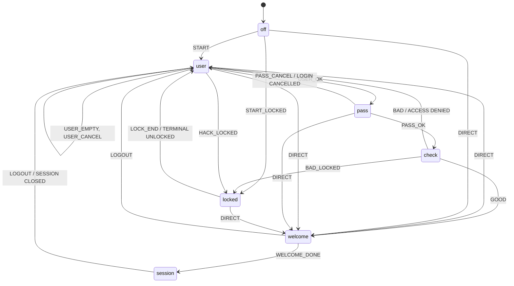

# Session: users and login

The session module holds the user database, the password hash, the login lockout and the login rules. The pure files are `src/session/sha256.c`, `src/session/uaf.c`, `src/session/lockout.c` and `src/session/login.c`. They do no file access and keep no global state. The session service runs them: see [The session service](#the-session-service). Nothing here is validated on real hardware.

## Files

| File | Prefix | What |
|---|---|---|
| `sha256.h` | `sha_` | SHA-256, FIPS 180-4, streaming |
| `uaf.h` | `uaf_` | `SYSUAF.DAT` check, load, write, lookup, hash, login check, user edits, privilege names |
| `lockout.h` | `lk_` | login failure count and lockout timer |
| `login.h` | `lg_` | the stepped password check, the login screen's states and messages, the idle rule |
| `sess.h` | `sess_` | the session service's public calls |
| `tools/mkuaf.py` | | builds and checks `SYSUAF.DAT` |

## SYSUAF.DAT layout

Little-endian, fixed width. The file is exactly `32 + count * 96` bytes.

Header, 32 bytes:

| Offset | Size | Field | Value |
|---|---|---|---|
| 0 | 8 | magic | `UOSUAF1` and a NUL |
| 8 | 2 | version | 1 |
| 10 | 2 | record_size | 96 |
| 12 | 2 | count | 0 to 32 |
| 14 | 2 | reserved | 0 |
| 16 | 4 | iterations | 1 to 100000 |
| 20 | 4 | crc32 | CRC-32/ISO-HDLC of all records, in order |
| 24 | 8 | reserved | 0 |

Record, 96 bytes:

| Offset | Size | Field | Rule |
|---|---|---|---|
| 0 | 16 | name | 1 to 16 of `A-Z 0-9 $ _`, upper-case, NUL padded; 16 characters leave no NUL |
| 16 | 16 | salt | any bytes |
| 32 | 32 | hash | the iterated hash below |
| 64 | 4 | privs | privilege bits |
| 68 | 4 | flags | flag bits |
| 72 | 16 | home | folder under `/UOS/HOME`, 1 to 8 of `A-Z 0-9 $ _ -`, upper-case, NUL padded |
| 88 | 8 | reserved | 0 |

`uaf_validate` checks in this order and returns the first failure: length at least 32 (`UAF_E_SHORT`), magic, version, record size, count, header reserved bytes, iterations, exact size, CRC, then each record: name (`UAF_E_NAME`, `UAF_E_NAME_PAD`), home (`UAF_E_HOME`, `UAF_E_HOME_PAD`), reserved bytes, and a name already seen (`UAF_E_DUPLICATE`). A record error also gives the record index. Bits in `privs` and `flags` outside the defined ones are not checked.

## Hash

```
h = SHA-256(salt || password)
repeat iterations - 1 times:
    h = SHA-256(h || salt || password)
```

The salt is 16 bytes. The password is 1 to 32 printable ASCII characters, 0x20 to 0x7E, case-sensitive, with no terminator in the hash input. Iterations come from the header. The tool's default is 2000.

`uaf_verify` always runs the full iteration count. For an unknown user it hashes against a dummy record with a zero salt. For a password that breaks the rules it hashes a dummy 32-character password. It compares all 32 bytes with no early exit. Unknown user and wrong password return the same code, `UAF_E_BAD_LOGIN`. `UAF_E_DISABLED` comes back only after a right password. The optional `uaf_work_t` counts SHA-256 messages and compressions so tests can check the work is the same in every case.

## Cost of one login check

A round hashes `32 + 16 + n` bytes for a password of `n` characters. That fits one 64-byte block for `n` up to 7 and takes two blocks from 8. At 2000 iterations one check takes 2000 compressions for short passwords and 3999 for passwords of 8 or more characters. The host test `worst_case_login_count` checks both numbers.

The login runs the check in steps, see [The stepped check](#the-stepped-check). Measured in QEMU, see [QEMU numbers](#qemu-numbers).

Estimate for an ARM1176 at 700 MHz, unverified. The cross GCC at `-O2` builds the compression loop as 47 instructions per round for rounds 0 to 15 and 66 for rounds 16 to 63, plus about 280 for loading and storing state. That is about 4200 instructions per compression. Buffer copies and padding add about 1000 instructions per hash. The worst case is about 19 million instructions. With caches on, at about 1.3 cycles per instruction, that is about 35 ms. With caches off, every fetch and load goes to SDRAM; at an assumed 15 to 25 cycles per instruction it is 0.4 to 0.7 s. The default stays 2000 because the estimate is not clearly over half a second. The image turns the MMU and both caches on at boot, `mmu_enable()`, and the `ev=mmu result=on` marker shows it. `test_login.py` checks that marker in the login image. Nobody has measured this on a board.

## Privileges and flags

| Bit | Privilege | Meaning |
|---|---|---|
| 0 | `SYSTEM` | everything |
| 1 | `OPER` | device control, `SET HALT` |
| 2 | `SECURITY` | user management with `AUTHORIZE`, reading `SYSUAF.DAT` |
| 3 | `READALL` | read every home |

| Bit | Flag | Meaning |
|---|---|---|
| 0 | `DISABLED` | the account cannot log in |
| 1 | `NOHACK` | the user can never be the minigame target |

`uaf_privs_format` writes names in bit order joined by commas, or an empty string for none. It needs `UAF_PRIVS_TEXT_MAX` bytes, 32, for the full set. `uaf_privs_parse` reads a comma list, ignores case and spaces, and accepts optional parentheses. Each name may be shortened to a unique prefix, so `S` is an error and `SY` is `SYSTEM`.

## Public functions

- `sha_init`, `sha_update`, `sha_final`, `sha_digest`: SHA-256.
- `uaf_validate`, `uaf_load`: check an image; load it into a `uaf_db_t` the caller owns.
- `uaf_db_init`, `uaf_write`: start an empty database; write an image with a fresh CRC. A short buffer gives `UAF_E_BUFFER` and writes nothing.
- `uaf_check_name`, `uaf_check_home`, `uaf_check_password`: the rules.
- `uaf_find`: index by name, case-insensitive.
- `uaf_hash`, `uaf_hash_equal`, `uaf_verify`: the hash and the login check.
- `uaf_add`, `uaf_remove`, `uaf_set_password`, `uaf_set_privs`, `uaf_set_flags`, `uaf_set_home`: edits for `AUTHORIZE`. The caller supplies each salt. At most 32 users.
- `uaf_privs_format`, `uaf_privs_parse`, `uaf_priv_name`: privilege text.
- `uaf_strerror`, `lk_strerror`: one line per error code.
- `lk_init`, `lk_fail`, `lk_session_start`, `lk_locked`, `lk_remaining_s`, `lk_tries_left`: the lockout.

## Lockout rule

`lk_init` takes `retries`, 1 to 9, and `lockout_s`, 0 to 3600, from `UOS.CFG [login]`. Each failed login adds one to the count. When the count reaches `retries`, the login locks for `lockout_s` seconds and the count resets. A failure while locked is ignored. A session start clears the count. With `lockout_s = 0` nothing locks. `lk_remaining_s` gives the whole seconds left, rounded up, for the screen.

Ticks are milliseconds in a `uint32_t`, which wraps every 2^32 ms, about 49.7 days. The code only uses `now - start` in 32 bits, so a lock that spans the wrap works. The caller must call an `lk_` function at least once per wrap period while locked. The session service does that on every tick.

`lk_lock(lk, now, seconds)` locks for a given length, whatever the count: the password game's loss uses it, so the terminal has one lock state. While a lock runs, the one that ends later wins. The count starts again when the lock ends. `lk_t.lock_ms` holds the length of the running lock.

`lk_fail` and `lk_lock` return `LK_STARTED` when the call starts a lock, and 1 when a lock that started earlier still runs. The session keeps the start tick in `sess.lock_tick` only on `LK_STARTED`. The lockout start marker prints that tick, so a failure during a running lock keeps the running lock's start.

### Lockout events

The password login and the password game share one lockout state. This table is the whole state machine. The same table is in `lockout.h`, and `tests/host/test_session_lockout.c` has a test per row.

| Event | Call | Failure count | Lock |
|---|---|---|---|
| Wrong password | `lk_fail` | Plus one. At `retries` it goes to 0 | Starts for `[login] lockout_s` at `retries` |
| Unknown user | `lk_fail` | As a wrong password | As a wrong password |
| Right password, account disabled | `lk_fail` | As a wrong password. The screen never tells the password was right | As a wrong password |
| Right password | `lk_session_start` from `sess_begin()` | 0 | None can run |
| Game started | none | Kept | None can run: a locked terminal refuses the game |
| Game left with BACK | none | Kept, whatever the wrong guesses | Unchanged |
| Game lost | `lk_lock` | 0 | Starts for `[hack] lockout_s`. With 0 s nothing changes |
| Game won | `lk_session_start` from `sess_begin()` | 0 | None can run |
| Game refused: off, disabled, `NOHACK`, covered, busy, locked | none | Kept | Unchanged |
| Logout or idle timeout | none | Kept | None can run during a session |
| Key while locked | `lk_fail` is ignored | 0 | Unchanged |
| Lock runs out | `lk_locked` | 0: failures from before the lock do not carry over | Ends |
| Reboot | `lk_init` | 0 | None: the state lives in RAM |

`sess_begin()` is the one way into a session, so a right password, a won game and the test-only `sess login` all clear the count. Since the session starts before the login's result marker, `session state=start` comes before `login user= result=ok` on the serial line.

A game cannot be won while locked: the game refuses to start with `locked`, and nothing locks while it plays, since no password can be typed then. Alternating password tries and game starts does not dodge the login lockout: a game start leaves the count as it was.

The lockout lives in RAM. A reboot clears it. A later option can keep the lock across a reboot by storing `locked_at` and the count on the card.

## mkuaf.py

```
python3 tools/mkuaf.py build USERS.INI -o SYSUAF.DAT [--seed TEXT] [--iterations N]
python3 tools/mkuaf.py check SYSUAF.DAT
python3 tools/mkuaf.py vectors -o tests/vectors/uaf.json
python3 tools/mkuaf.py vectors-h tests/vectors/uaf.json -o uaf_vectors.h
```

`USERS.INI` has one section per user. The section name is the user name. Keys: `password` (required), `privs` (a comma list or a number, default none), `home` (default the user name), `flags` (`DISABLED`, `NOHACK` as a list, or a number). Unknown keys are errors. Without `--seed` each salt comes from `os.urandom`. With `--seed` the salt is the first 16 bytes of `SHA-256(seed || 0x00 || NAME)`. `check` validates like `uaf_validate` and lists users, homes, privileges and flags. It never prints salts or hashes.

Exit codes: 0 success, 1 bad input or a bad file with a `mkuaf:` message on stderr, 2 bad usage.

The shared vectors in `tests/vectors/uaf.json` come from `vectors`. The C test reads them through a header that `vectors-h` generates during the build. A header is simpler than a JSON parser in C.

## Default users

`card/UOS/SYSUAF.DAT` is built from `tools/default_users.ini` with `--seed uos-default-card`. The card holds no `USERS.INI`. `card/UOS/SYSUAF.DEF` is a copy of it, for the maintenance image's restore users tool: rebuild both together.

| User | Password | Privileges | Flags |
|---|---|---|---|
| `ADMIN` | `ADMIN-CHANGE-ME` | `SYSTEM` | `NOHACK` |
| `OPER` | `OPER-CHANGE-ME` | `OPER` | `NOHACK` |
| `GUEST` | `GUEST` | none | none, so the minigame may log in as `GUEST` |

Change these passwords before you use a terminal. Anyone who reads this page knows them.

## The stepped check

`lg_check_begin()` copies what a check needs: the user's salt and hash, or zeros for an unknown user, and the password, or 32 dots when it breaks the rules. These are the rules of `uaf_verify()`. The caller may wipe its own copy of the password at once.

`lg_check_step(c, budget)` runs `lg_rounds_per_step()` rounds: the budget divided by the compressions per round, 1 for a password up to 7 characters and 2 from 8, and at least 1. The service passes `LG_STEP_BLOCKS`, 256. A check of 2000 iterations takes 8 steps for a short password and 16 for a long one. An unknown user takes the same steps as a known one with the same password length.

`lg_check_end()` compares the 32 bytes with `uaf_hash_equal()`, which never stops early, then clears the whole struct with volatile writes. It returns what `uaf_verify()` returns. A check that has not run every round never passes. `test_session_login.c` checks the results and the work against `uaf_verify()` for every case.

## The login rules

`lg_next(state, event)` is the login screen's state machine. Every screen change of the session service goes through it.



`DIRECT` is the test-only `sess login`. Any other event leaves the state as it is: input while locked, a second start, a logout with nobody logged in.

Other rules in `login.c`:

- `lg_denied_line()`: the one message after a failed login, `ACCESS DENIED. 2 ATTEMPTS LEFT.`, for an unknown user and a wrong password alike.
- `lg_lockout_apply()`: `[login] retries` and `lockout_s` through `lk_init()`; when it refuses them, 3 and 30, and the caller marks a warning. The settings reader already clamps both, so this is a second guard.
- `lg_idle_expired()`: the idle rule, see [Idle time](#idle-time).
- `lg_db_notice()`: what the system screen says for each database state.
- `lg_name_word()`: the typed user name as one marker word.
- `lg_header_line()`, `lg_welcome_line()`, `lg_locked_line()`: screen text.
- `lg_notice_line()`: the notice on the last header row. It reads `SETTINGS: SOME VALUES IGNORED` for a bad `UOS.CFG`, `DEVICES: SOME DEVICES REFUSED` for device errors, both joined by a full stop, or nothing.

## The session service

The service `session`, `src/session/sessvc.c` and `sesscreen.c`, starts after `console` and before `devices`. See [Services](../ARCHITECTURE.md#services).

At start it reads `[login]` and `/UOS/SYSUAF.DAT` with `vfs_sys_read_all()`, at most 3104 bytes, and loads it with `uaf_load()`. It wipes the file buffer before it frees it. The database state:

| State | When | System screen |
|---|---|---|
| `ok` | The file loads | The login replaces the first screen after the banner |
| `nocard` | No card | `LOGIN IS NOT AVAILABLE WITHOUT A UOS CARD.` |
| `notree` | A card without `/UOS` | `LOGIN IS NOT AVAILABLE: NO /UOS FOLDER.` |
| `missing` | No `SYSUAF.DAT` | `USER DATABASE MISSING. NO ONE CAN LOG IN.` |
| `damaged` | A read error or a failed `uaf_load()` | `USER DATABASE DAMAGED (<WHY>). NO ONE CAN LOG IN.`, and `state` shows `error=userdb` |

In every state but `ok` the first screen stays, with a second row that says what to do, and F4 restarts the terminal. No login runs. The diagnostic keys of the first screen still work; they change nothing.

### Context rules

| Call | Context | Does |
|---|---|---|
| `sess_logged_in()` | any | Non-zero while a user is logged in |
| `sess_user()` | any | The name, upper-case, at most 16 characters, or `""` |
| `sess_id()` | any | The session's identity, 0 with no session. It changes at each login and each logout, so a posted call that kept it knows when its session is gone |
| `sess_privs()` | any | The privilege bits of `uos_privs.h`, or 0 |
| `sess_flags()` | any | `UAF_FLAG_NOHACK` and the others, or 0 |
| `sess_home()` | any | The home folder under `/UOS/HOME`, as `vp_ctx_t.home` takes it, or `""` |
| `sess_vp_ctx(ctx)` | any | A file system context for the user, by `vp_ctx_init()` |
| `sess_logout(reason)` | loop | Ends the session, see below |
| `sess_end_name(reason)` | any | `user`, `maint`, `idle`, `shell` |
| `sess_set_next(fn)` | loop | Registers the screen after login, once per boot |
| `sess_db()` | any | The database, read only, or NULL |
| `sess_find(name)` | any | One record, read only, or NULL |
| `sess_reload()` | loop | Reads `SYSUAF.DAT` again after the shell wrote it. The session keeps its privileges until the next login. |

"Any" calls read state and change nothing, so they are safe from a maintenance command, an IRQ or the panic path. "Loop" calls run from a screen callback, a timer, a posted call or a service init.

`sess_logout()` clears every session field and `uos.user`, prints the end marker, removes every screen above the bottom one and shows the login. A read, a pager or a pause on the stack ends without calling back: the console screens have a `leave` that does this when another caller pops them. The read's text is wiped.

`sess_set_next(fn)` takes a function that returns the screen to show after the welcome. The shell service registers it at its init, see [The shell](../ARCHITECTURE.md#the-shell). Without a registration, or when the function returns NULL, the session ends with `SESS_END_SHELL` and the marker `session screen=none`. The placeholder screen of earlier builds is gone.

### The login screen

The screen shows a header, then `USERNAME:` and `PASSWORD:` read by `con_read_line()`. The last header row holds the notice of `lg_notice_line()`, bright, and goes to the serial line with the other rows. At the first login after boot, the first screen already printed the banner, so only the notice goes to the serial line. The device part is set when `devs_cfg_errors()` is not 0. The user name is at most 16 characters with no history. The password is at most 32 characters, masked, with no history. Both work from the serial console and from the on-screen keyboard, which a GPIO button opens. When the next user name read is due while another screen covers the login, such as the holotape reader, the login starts it in its `uncover()` callback once that screen closes. See [Covered screens](../ARCHITECTURE.md#covered-screens).

- Ctrl-C or an empty line at `USERNAME:` brings the prompt back. BACK on an empty line does nothing. Nothing counts.
- Ctrl-C at `PASSWORD:` shows `LOGIN CANCELLED.` and goes back to `USERNAME:`. Nothing counts.
- After the password the screen shows `CHECKING CREDENTIALS...`. The check runs one step per loop pass, posted to the loop, so the tick, the input layer and the device watchdog run between two steps. Keys during the check are dropped.
- A failed check counts once with `lk_fail()` and shows `ACCESS DENIED. N ATTEMPTS LEFT.`. A disabled account with a right password counts and shows the same: the screen never says that the password was right.
- When the count reaches `retries`, the lockout screen replaces the login. It shows `TERMINAL LOCKED: TOO MANY FAILED LOGINS.` and `TRY AGAIN IN N SECONDS.`, which a 1 second timer updates. Every key is refused. The tick ends the lock on time, then the login comes back with `TERMINAL UNLOCKED. YOU MAY TRY AGAIN.`.
- A good login clears the count. The welcome shows the name and the privileges for 1.5 s or until a key, then the registered screen. `SYSUAF.DAT` stores no last login, so the welcome shows none.

### Secrets

- The password goes from the console's buffer to the check's copy. The console wipes its buffer after the callback. The check clears its copy, the hashes and the salt when it ends.
- Hashes compare in constant time.
- An unknown user takes the same steps and the same marker as a wrong password.
- No marker, no port answer and no panic text holds a password, a salt or a hash. The PL011 echo of the password is one `*` per character. `test_login.py` greps the whole serial log of a session for each password and for every salt and hash in hex.
- The user name is not secret: the screen and the markers show it.

### Idle time

`[login] idle_s`, 0 to 86400, default 0. 0 means a session never ends on idle time. Otherwise the service's `tick` ends the session with reason `idle` once `idle_s` seconds pass with no key or character from the input layer since the later of the last key and the login. The loop records the tick of every key it takes, `uos_last_input()`.

### Markers

| Marker | When |
|---|---|
| `sessdb result=<state> users= iterations= why= rec=` | At start |
| `sesscfg result=<ok\|fallback> retries= lockout_s= idle_s=` | At start |
| `sesswarn why=lockout count=` | The `[login]` values were refused |
| `login state=<user\|pass\|check>` | A prompt or the check starts. `rc=` is the result of `con_read_line()` |
| `login user=<NAME> result=<ok\|bad> left= steps= ticks= us= maxstep_us=` | A check ended. `left` is the tries left. `us` is from the check's start to its end, `maxstep_us` the longest step |
| `lockout state=start s= t= why=<login\|hack>`, `lockout s=`, `lockout state=end t= why=` | The lock starts, each second of the countdown, the lock ends. `t` is the tick the lock itself used: the start tick of the lock, and the tick that saw it expire. `why` is what locked it |
| `login state=hack` | F2 on an empty user name: the password game's entry |
| `session state=start user= privs= how=<login\|test\|hack>` | A session starts. `hack` is a won password game |
| `session result=refused why= how=hack` | `sess_hack_begin()` refused |
| `session screen=<name>` | The screen after the welcome |
| `session state=end user= reason=<user\|maint\|idle\|shell>` | A session ends |
| `session result=<none\|busy\|nouser>` | `sess logout` or `sess login` did nothing |

### Maintenance commands

| Command | Answer |
|---|---|
| `sess state` | `sess state= db= user= privs= flags= home= tries= locked_s= idle_s= pending=`. `pending` counts input events not handled yet, `uos_input_pending()`: a test waits for 0 before it reads the state. |
| `sess logout` | Posts `sess_logout(SESS_END_MAINT)`. A `session state=end` or `session result=none` marker follows. |
| `sess login <user>` | Test builds only. Starts a session with no password, through the welcome, so later tasks test their screens without the hash cost. The posted call carries the name in one of 4 slots, so two commands in one port write keep their own names and run in order: the first opens its session, the second marks `session result=busy`. A fifth command while 4 wait answers `err full`. The shipped image does not contain it: `test_login.py` checks with `nm`. |

### QEMU numbers

One check of 2000 iterations in QEMU, from `test_login.py -s`, two logins per user on each board. These are QEMU numbers on the test host. QEMU does not model caches, and they say nothing about a real Pi.

| Board | `ADMIN`, 15 characters, 3999 compressions | `GUEST`, 5 characters, 2000 compressions | Longest step |
|---|---|---|---|
| `raspi0` | 9.5 to 10.2 ms | 7.3 to 7.4 ms | 0.8 ms |
| `raspi1ap` | 9.2 to 10.0 ms | 6.7 to 6.9 ms | 0.8 ms |
| `raspi2b` | 8.9 to 17.5 ms | 6.7 to 6.9 ms | 0.9 ms |
| `raspi3b` | 12.5 to 13.7 ms | 8.5 to 10.5 ms | 0.9 ms |

The check takes 16 steps for `ADMIN` and `OPER` and 8 for `GUEST`, 0 to 2 ticks in all. On an ARM1176 with caches the estimate above gives about 35 ms for the worst case, about 2.2 ms per step.

## Tests

`make test-host` runs `test_session_sha256`, `test_session_uaf`, `test_session_lockout` and `test_session_login`. It first generates `build/host/gen/uaf_vectors.h` from `tests/vectors/uaf.json` with `tools/mkuaf.py vectors-h`. `make test-tools` runs `tests/tools/test_mkuaf.py`. `test_login.py` runs the service in QEMU. See [TESTING.md](../TESTING.md).

## The password game

The session service owns the rules of the password game's session. `lg_hack_allowed(enabled, db_ok, rec, state, locked)` is pure; the first failing rule wins:

| Code | Name | Rule |
|---|---|---|
| `LG_HACK_OFF` | `off` | `[hack] enabled = no` |
| `LG_HACK_NODB` | `nodb` | No user database |
| `LG_HACK_NOUSER` | `nouser` | The `[hack] user` does not exist |
| `LG_HACK_DISABLED` | `disabled` | The account has `UAF_FLAG_DISABLED` |
| `LG_HACK_NOHACK` | `nohack` | The account has `UAF_FLAG_NOHACK` |
| `LG_HACK_LOCKED` | `locked` | The lockout runs |
| `LG_HACK_BUSY` | `busy` | Someone is logged in, or the login is not at the user name prompt |

`sess_hack_check()` applies it to the live state. `sess_hack_begin()` checks again and starts the session with `how=hack`, through the welcome, as a login does. `sess_hack_lock()` locks with `lk_lock()` for `[hack] lockout_s` and shows the lockout screen, which then reads `TERMINAL LOCKED: PASSWORD RECOVERY FAILED.`. With `lockout_s = 0` nothing locks and the login prompt comes back.

The login's user name read has `CON_RL_ALTKEY`: F2 on an empty line ends it with `CON_ALT`, and the login calls the function of `sess_set_hack_entry()`. A GPIO button opens the on-screen keyboard instead, so a terminal with buttons only cannot start the game from the login yet.
